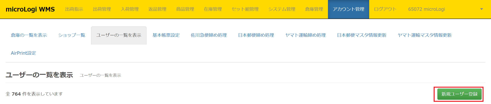
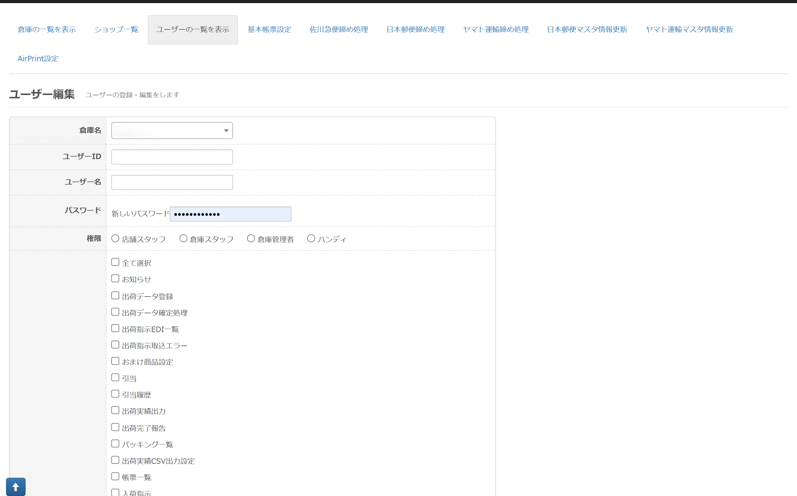
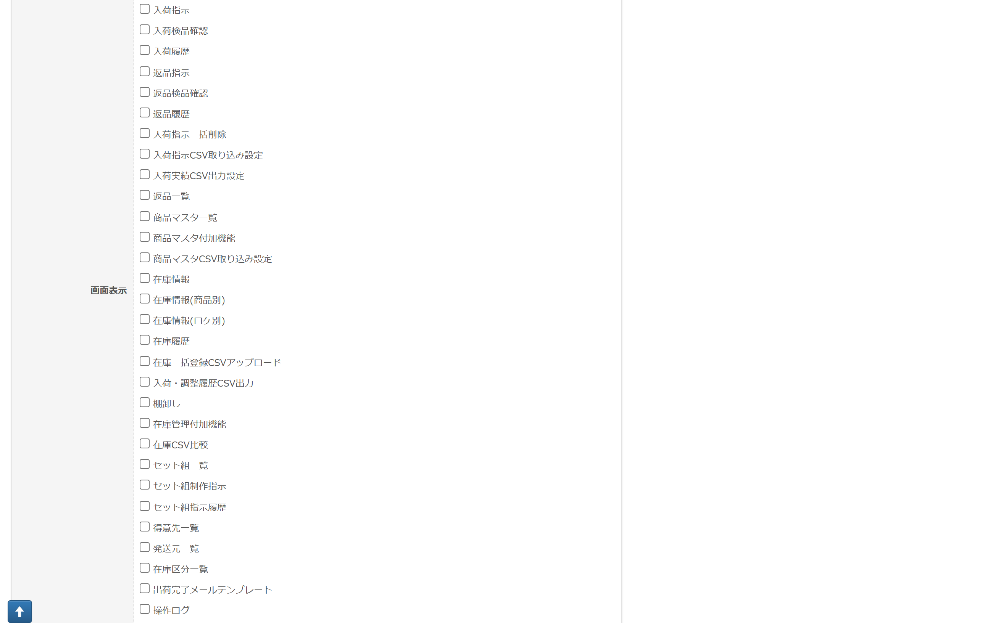
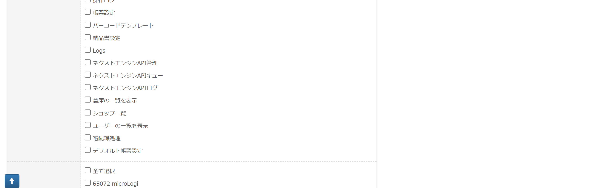
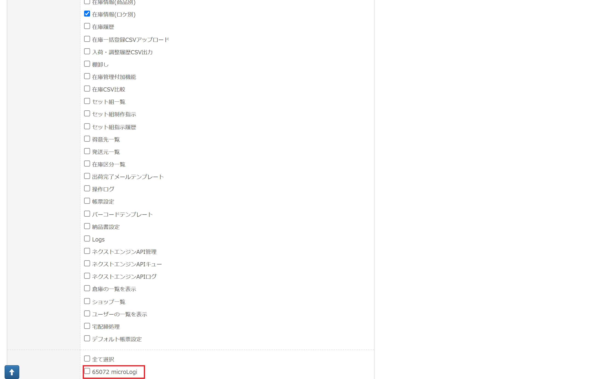
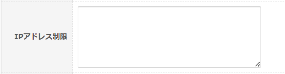
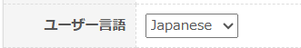

ユーザーの一覧を表示では、 ①店舗スタッフ、②倉庫スタッフ、③倉庫管理者、④ハンディの新規登録・権限編集が行えます。 ※③倉庫管理者でないと設定が出来ません。 ※ショップのメールアドレスとして登録されているメールアドレスを 　ログインIDとしてユーザーアカウントを発行することはできません。 ＊必ず、どちらの権限でも【お知らせ】には☑をお願いいたします。

以下の画面より登録を行います。

デフォルトで①店舗スタッフ、② 倉庫スタッフ、③倉庫管理者は●の権限が付与されておりますが、当 画面で権限の設定変更が可能です。  ●・・・デフォルト、△・・・チェックを入れて変更可

※必ず【お知らせ】には☑を入れてください。

※2020年5月11日現在、店舗スタッフ権限で商品マスタCSV取り込み設定、帳票一覧、アプリ操作ログは閲覧出来ませ　ん。

※2025年4月22日　倉庫スタッフ権限の方に【宅配締処理】の権限を追加されたい場合は、アカウント管理の他の

　　　　　　　　　機能に☑を入れてしまうと【宅配締処理】もご利用いただくことができません。

　　　　　　　　　アカウント管理機能では【宅配締処理】のみに☑を入れてご利用ください。

<table><tbody><tr><td class="wysiwyg-text-align-center">メニュー</td><td class="wysiwyg-text-align-center">項目</td><td class="wysiwyg-text-align-center">店舗スタッフ</td><td class="wysiwyg-text-align-center">倉庫スタッフ</td><td class="wysiwyg-text-align-center">倉庫管理者</td></tr><tr><td>　</td><td>お知らせ</td><td class="wysiwyg-text-align-center">●</td><td class="wysiwyg-text-align-center">●</td><td class="wysiwyg-text-align-center">●</td></tr><tr><td rowspan="5">出荷指示</td><td>出荷データ登録</td><td class="wysiwyg-text-align-center">●</td><td class="wysiwyg-text-align-center">●</td><td class="wysiwyg-text-align-center">●</td></tr><tr><td>出荷データ確定処理</td><td class="wysiwyg-text-align-center">●</td><td class="wysiwyg-text-align-center">●</td><td class="wysiwyg-text-align-center">●</td></tr><tr><td>出荷指示EDI一覧</td><td class="wysiwyg-text-align-center">●</td><td class="wysiwyg-text-align-center">△</td><td class="wysiwyg-text-align-center">●</td></tr><tr><td>出荷指示取込エラー</td><td class="wysiwyg-text-align-center">●</td><td class="wysiwyg-text-align-center">●</td><td class="wysiwyg-text-align-center">●</td></tr><tr><td>おまけ商品設定</td><td class="wysiwyg-text-align-center">●</td><td class="wysiwyg-text-align-center">△</td><td class="wysiwyg-text-align-center">●</td></tr><tr><td rowspan="11">出荷管理</td><td>引当</td><td class="wysiwyg-text-align-center">△</td><td class="wysiwyg-text-align-center">●</td><td class="wysiwyg-text-align-center">●</td></tr><tr><td>引当履歴</td><td class="wysiwyg-text-align-center">●</td><td class="wysiwyg-text-align-center">●</td><td class="wysiwyg-text-align-center">●</td></tr><tr><td>出荷実績出力</td><td class="wysiwyg-text-align-center">●</td><td class="wysiwyg-text-align-center">●</td><td class="wysiwyg-text-align-center">●</td></tr><tr><td>ニッセン後払いCSVアップロード</td><td class="wysiwyg-text-align-center">●</td><td class="wysiwyg-text-align-center">●</td><td class="wysiwyg-text-align-center">●</td></tr><tr><td>出荷完了報告</td><td class="wysiwyg-text-align-center">△</td><td class="wysiwyg-text-align-center">●</td><td class="wysiwyg-text-align-center">●</td></tr><tr><td>パッキング一覧</td><td class="wysiwyg-text-align-center">△</td><td class="wysiwyg-text-align-center">●</td><td class="wysiwyg-text-align-center">●</td></tr><tr><td>出荷実績CSV出力設定</td><td class="wysiwyg-text-align-center">●</td><td class="wysiwyg-text-align-center">●</td><td class="wysiwyg-text-align-center">●</td></tr><tr><td>補充リスト</td><td class="wysiwyg-text-align-center">●</td><td class="wysiwyg-text-align-center">●</td><td class="wysiwyg-text-align-center">●</td></tr><tr><td>帳票一覧</td><td class="wysiwyg-text-align-center">△</td><td class="wysiwyg-text-align-center">△</td><td class="wysiwyg-text-align-center">●</td></tr><tr><td>送り状CSV実績設定</td><td class="wysiwyg-text-align-center">●</td><td class="wysiwyg-text-align-center">●</td><td class="wysiwyg-text-align-center">●</td></tr><tr><td>引当検索条件</td><td class="wysiwyg-text-align-center">●</td><td class="wysiwyg-text-align-center">●</td><td class="wysiwyg-text-align-center">●</td></tr><tr><td rowspan="10">入荷管理</td><td>入荷指示</td><td class="wysiwyg-text-align-center">●</td><td class="wysiwyg-text-align-center">●</td><td class="wysiwyg-text-align-center">●</td></tr><tr><td>入荷検品確認</td><td class="wysiwyg-text-align-center">△</td><td class="wysiwyg-text-align-center">●</td><td class="wysiwyg-text-align-center">●</td></tr><tr><td>入荷履歴</td><td class="wysiwyg-text-align-center">●</td><td class="wysiwyg-text-align-center">●</td><td class="wysiwyg-text-align-center">●</td></tr><tr><td>返品指示</td><td class="wysiwyg-text-align-center">△</td><td class="wysiwyg-text-align-center">●</td><td class="wysiwyg-text-align-center">●</td></tr><tr><td>返品検品確認</td><td class="wysiwyg-text-align-center">△</td><td class="wysiwyg-text-align-center">●</td><td class="wysiwyg-text-align-center">●</td></tr><tr><td>返品履歴</td><td class="wysiwyg-text-align-center">●</td><td class="wysiwyg-text-align-center">●</td><td class="wysiwyg-text-align-center">●</td></tr><tr><td>入荷指示一括削除</td><td class="wysiwyg-text-align-center">△</td><td class="wysiwyg-text-align-center">●</td><td class="wysiwyg-text-align-center">●</td></tr><tr><td>入荷指示CSV取り込み設定</td><td class="wysiwyg-text-align-center">●</td><td class="wysiwyg-text-align-center">●</td><td class="wysiwyg-text-align-center">●</td></tr><tr><td>入荷実績CSV出力設定</td><td class="wysiwyg-text-align-center">●</td><td class="wysiwyg-text-align-center">●</td><td class="wysiwyg-text-align-center">●</td></tr><tr><td>入荷検品データ取込</td><td class="wysiwyg-text-align-center">●</td><td class="wysiwyg-text-align-center">●</td><td class="wysiwyg-text-align-center">●</td></tr><tr><td rowspan="2">返品管理</td><td>返品一覧</td><td class="wysiwyg-text-align-center">●</td><td class="wysiwyg-text-align-center">●</td><td class="wysiwyg-text-align-center">●</td></tr><tr><td>返品一覧出力設定</td><td class="wysiwyg-text-align-center">●</td><td class="wysiwyg-text-align-center">●</td><td class="wysiwyg-text-align-center">●</td></tr><tr><td rowspan="4">商品管理</td><td>商品マスタ一覧</td><td class="wysiwyg-text-align-center">●</td><td class="wysiwyg-text-align-center">●</td><td class="wysiwyg-text-align-center">●</td></tr><tr><td>商品マスタ付加機能</td><td class="wysiwyg-text-align-center">●</td><td class="wysiwyg-text-align-center">●</td><td class="wysiwyg-text-align-center">●</td></tr><tr><td>商品マスタCSV取り込み設定</td><td class="wysiwyg-text-align-center">　</td><td class="wysiwyg-text-align-center">△</td><td class="wysiwyg-text-align-center">●</td></tr><tr><td>商品データCSV出力設定</td><td class="wysiwyg-text-align-center">●</td><td class="wysiwyg-text-align-center">●</td><td class="wysiwyg-text-align-center">●</td></tr><tr><td rowspan="17">在庫管理</td><td>在庫情報</td><td class="wysiwyg-text-align-center">●</td><td class="wysiwyg-text-align-center">●</td><td class="wysiwyg-text-align-center">●</td></tr><tr><td>在庫情報(商品別)</td><td class="wysiwyg-text-align-center">△</td><td class="wysiwyg-text-align-center">●</td><td class="wysiwyg-text-align-center">●</td></tr><tr><td>在庫情報(ロケ別)</td><td class="wysiwyg-text-align-center">△</td><td class="wysiwyg-text-align-center">●</td><td class="wysiwyg-text-align-center">●</td></tr><tr><td>在庫履歴</td><td class="wysiwyg-text-align-center">●</td><td class="wysiwyg-text-align-center">●</td><td class="wysiwyg-text-align-center">●</td></tr><tr><td>在庫一括登録CSVアップロード</td><td class="wysiwyg-text-align-center">△</td><td class="wysiwyg-text-align-center">△</td><td class="wysiwyg-text-align-center">●</td></tr><tr><td>入荷・調整履歴CSV出力</td><td class="wysiwyg-text-align-center">△</td><td class="wysiwyg-text-align-center">△</td><td class="wysiwyg-text-align-center">●</td></tr><tr><td>棚卸し</td><td class="wysiwyg-text-align-center">△</td><td class="wysiwyg-text-align-center">△</td><td class="wysiwyg-text-align-center">●</td></tr><tr><td>定期補充</td><td class="wysiwyg-text-align-center">●</td><td class="wysiwyg-text-align-center">●</td><td class="wysiwyg-text-align-center">●</td></tr><tr><td>ロケーション管理</td><td class="wysiwyg-text-align-center">●</td><td class="wysiwyg-text-align-center">●</td><td class="wysiwyg-text-align-center">●</td></tr><tr><td>在庫管理付加機能</td><td class="wysiwyg-text-align-center">△</td><td class="wysiwyg-text-align-center">●</td><td class="wysiwyg-text-align-center">●</td></tr><tr><td>在庫CSV比較</td><td class="wysiwyg-text-align-center">　</td><td class="wysiwyg-text-align-center">△</td><td class="wysiwyg-text-align-center">●</td></tr><tr><td>在庫情報CSV設定</td><td class="wysiwyg-text-align-center">●</td><td class="wysiwyg-text-align-center">●</td><td class="wysiwyg-text-align-center">●</td></tr><tr><td>在庫履歴一覧出力設定</td><td class="wysiwyg-text-align-center">●</td><td class="wysiwyg-text-align-center">●</td><td class="wysiwyg-text-align-center">●</td></tr><tr><td>GASゾーンマスタ</td><td class="wysiwyg-text-align-center">●</td><td class="wysiwyg-text-align-center">●</td><td class="wysiwyg-text-align-center">●</td></tr><tr><td>当日 棚卸リスト</td><td class="wysiwyg-text-align-center">●</td><td class="wysiwyg-text-align-center">●</td><td class="wysiwyg-text-align-center">●</td></tr><tr><td>ゾーングループ</td><td class="wysiwyg-text-align-center">●</td><td class="wysiwyg-text-align-center">●</td><td class="wysiwyg-text-align-center">●</td></tr><tr><td>在庫調整情報CSV出力</td><td class="wysiwyg-text-align-center">●</td><td class="wysiwyg-text-align-center">●</td><td class="wysiwyg-text-align-center">●</td></tr><tr><td rowspan="5">セット組管理</td><td>セット組一覧</td><td class="wysiwyg-text-align-center">●</td><td class="wysiwyg-text-align-center">●</td><td class="wysiwyg-text-align-center">●</td></tr><tr><td>セット組制作指示</td><td class="wysiwyg-text-align-center">●</td><td class="wysiwyg-text-align-center">●</td><td class="wysiwyg-text-align-center">●</td></tr><tr><td>セット組指示履歴</td><td class="wysiwyg-text-align-center">●</td><td class="wysiwyg-text-align-center">●</td><td class="wysiwyg-text-align-center">●</td></tr><tr><td>バラシ</td><td class="wysiwyg-text-align-center">●</td><td class="wysiwyg-text-align-center">●</td><td class="wysiwyg-text-align-center">●</td></tr><tr><td>バラシ履歴</td><td class="wysiwyg-text-align-center">●</td><td class="wysiwyg-text-align-center">●</td><td class="wysiwyg-text-align-center">●</td></tr><tr><td rowspan="23">システム管理</td><td>得意先一覧</td><td class="wysiwyg-text-align-center">●</td><td class="wysiwyg-text-align-center">△</td><td class="wysiwyg-text-align-center">●</td></tr><tr><td>発送元一覧</td><td class="wysiwyg-text-align-center">●</td><td class="wysiwyg-text-align-center">△</td><td class="wysiwyg-text-align-center">●</td></tr><tr><td>在庫区分一覧</td><td class="wysiwyg-text-align-center">△</td><td class="wysiwyg-text-align-center">△</td><td class="wysiwyg-text-align-center">●</td></tr><tr><td>出荷完了メール設定</td><td class="wysiwyg-text-align-center">●</td><td class="wysiwyg-text-align-center">△</td><td class="wysiwyg-text-align-center">●</td></tr><tr><td>個別帳票設定</td><td class="wysiwyg-text-align-center">●</td><td class="wysiwyg-text-align-center">●</td><td class="wysiwyg-text-align-center">●</td></tr><tr><td>WMS操作ログ</td><td class="wysiwyg-text-align-center">●</td><td class="wysiwyg-text-align-center">●</td><td class="wysiwyg-text-align-center">●</td></tr><tr><td>アプリ操作ログ</td><td class="wysiwyg-text-align-center">　</td><td class="wysiwyg-text-align-center">△</td><td class="wysiwyg-text-align-center">●</td></tr><tr><td>のし設定</td><td class="wysiwyg-text-align-center">●</td><td class="wysiwyg-text-align-center">●</td><td class="wysiwyg-text-align-center">●</td></tr><tr><td>メッセージカード設定</td><td class="wysiwyg-text-align-center">●</td><td class="wysiwyg-text-align-center">●</td><td class="wysiwyg-text-align-center">●</td></tr><tr><td>バーコード設定</td><td class="wysiwyg-text-align-center">△※1</td><td class="wysiwyg-text-align-center">●</td><td class="wysiwyg-text-align-center">●</td></tr><tr><td>納品書設定</td><td class="wysiwyg-text-align-center">●</td><td class="wysiwyg-text-align-center">△</td><td class="wysiwyg-text-align-center">●</td></tr><tr><td>アプリ操作ログ</td><td class="wysiwyg-text-align-center">△</td><td class="wysiwyg-text-align-center">△</td><td class="wysiwyg-text-align-center">●</td></tr><tr><td>ネクストエンジンAPI管理</td><td class="wysiwyg-text-align-center">△</td><td class="wysiwyg-text-align-center">△</td><td class="wysiwyg-text-align-center">●</td></tr><tr><td>ネクストエンジンAPIキュー</td><td class="wysiwyg-text-align-center">△</td><td class="wysiwyg-text-align-center">△</td><td class="wysiwyg-text-align-center">●</td></tr><tr><td>ネクストエンジンAPIログ</td><td class="wysiwyg-text-align-center">△</td><td class="wysiwyg-text-align-center">△</td><td class="wysiwyg-text-align-center">●</td></tr><tr><td>自動請求システム</td><td class="wysiwyg-text-align-center">●</td><td class="wysiwyg-text-align-center">●</td><td class="wysiwyg-text-align-center">●</td></tr><tr><td>仕入先マスタ</td><td class="wysiwyg-text-align-center">●</td><td class="wysiwyg-text-align-center">●</td><td class="wysiwyg-text-align-center">●</td></tr><tr><td>応用設定</td><td class="wysiwyg-text-align-center">●</td><td class="wysiwyg-text-align-center">●</td><td class="wysiwyg-text-align-center">●</td></tr><tr><td>AirPrint設定</td><td class="wysiwyg-text-align-center">●</td><td class="wysiwyg-text-align-center">●</td><td class="wysiwyg-text-align-center">●</td></tr><tr><td>WMSスケジュール</td><td class="wysiwyg-text-align-center">●</td><td class="wysiwyg-text-align-center">●</td><td class="wysiwyg-text-align-center">●</td></tr><tr><td>WMSタスク</td><td class="wysiwyg-text-align-center">●</td><td class="wysiwyg-text-align-center">●</td><td class="wysiwyg-text-align-center">●</td></tr><tr><td>スケジュールログ</td><td class="wysiwyg-text-align-center">●</td><td class="wysiwyg-text-align-center">●</td><td class="wysiwyg-text-align-center">●</td></tr><tr><td>箱マスタ</td><td class="wysiwyg-text-align-center">●</td><td class="wysiwyg-text-align-center">●</td><td class="wysiwyg-text-align-center">●</td></tr><tr><td>倉庫管理</td><td>　</td><td class="wysiwyg-text-align-center">　</td><td class="wysiwyg-text-align-center">　</td><td class="wysiwyg-text-align-center">●</td></tr><tr><td rowspan="5">アカウント管理</td><td>倉庫の一覧を表示</td><td class="wysiwyg-text-align-center">　</td><td class="wysiwyg-text-align-center">　</td><td class="wysiwyg-text-align-center">●</td></tr><tr><td>ショップ一覧</td><td class="wysiwyg-text-align-center">　</td><td class="wysiwyg-text-align-center">　</td><td class="wysiwyg-text-align-center">●</td></tr><tr><td>ユーザーの一覧を表示</td><td class="wysiwyg-text-align-center">　</td><td class="wysiwyg-text-align-center">　</td><td class="wysiwyg-text-align-center">●</td></tr><tr><td>宅配締処理</td><td class="wysiwyg-text-align-center">&nbsp;</td><td class="wysiwyg-text-align-center">△</td><td class="wysiwyg-text-align-center">●</td></tr><tr><td>マスタ情報更新</td><td class="wysiwyg-text-align-center">　</td><td class="wysiwyg-text-align-center">　</td><td class="wysiwyg-text-align-center">●</td></tr></tbody></table>

※1　設定したバーコードテンプレートを使用してバーコードを出力する場合、☑をつける必要がある。

操作権限を付与したいショップをチェックで選択します。

IP制限を行いたい場合には、以下にIPアドレスを記載します。

複数先を指定する場合は改行にてご登録ください。

言語は、日本語と英語が選択可能です。

