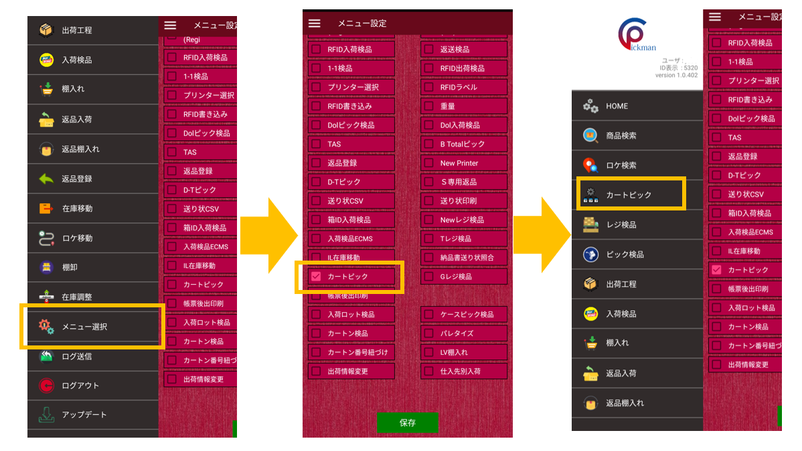
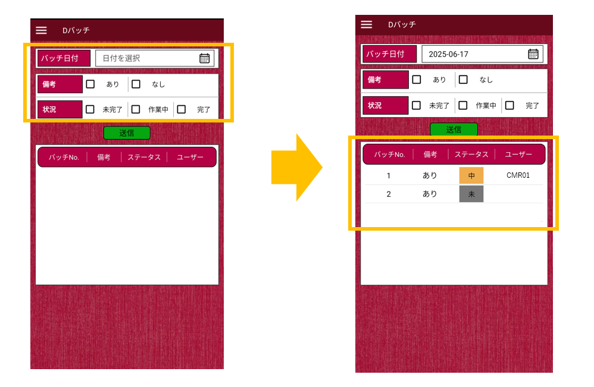
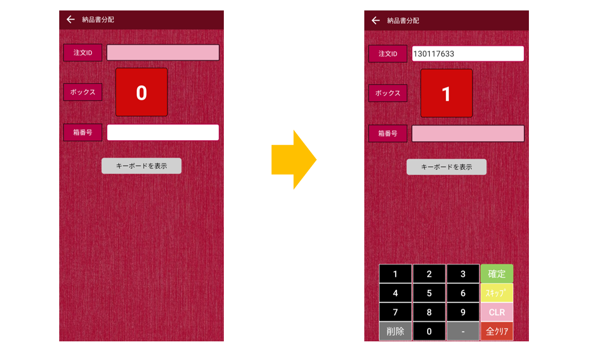
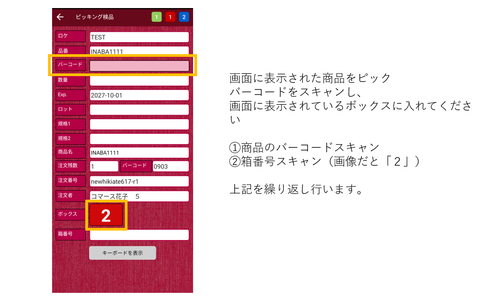
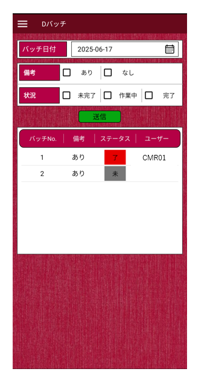

<h1>カートピック</h1>

💡　この機能をご利用の際には、事前に\[メニュー選択\]にて機能を有効化してください。

  

本機能では、作成されたバッチに基づき、ピッキングしながらTASを行うことが可能です。

## **設定方法**

* * *

①　\[メニュー選択\]を開く

②　「カートピック」の左横チェックボックスにチェックをいれ［保存］ボタンをクリック

③　メニュー画面に「カートピック」のメニューが表示されます

## **操作方法**

#### **①バッチを作成する。**

#### **②Pickmanでカートピックの画面を開く**

#### **③バッチ日付で作業を行いたいバッチを検索（送信）する。**

　※検索結果が送信ボタンの下に表示されます。  
　※作業中の場合、ステータスが「中」になります。

#### **④納品書振り分け**

作業したいバッチの行をクリックすると納品書をカートの中の間口に振り分けを行う画面に切り替わります。

注文IDをスキャンし、指示されたボックス番号を箱番号の枠に入力してください。  
※上記であれば箱番号に「1」を入力します。

上記を作業するバッチに含まれる注文数分、繰り返し行ってください。  
※1バッチに10注文存在する場合は、10回注文IDをスキャンし10間口に帳票を振り分けるイメージです。

終了すると、ピッキング検品画面に遷移します。

#### **⑤ピッキング検品を行う**

スキャン対象の商品カテゴリは「商品」と「同梱物」になります。

資材もスキャン対象としたい場合は、HOME画面のALL Settingsで「**BTpic資材含**」に☑をいれてください。

完了すると、ステータスが「了」となります。

