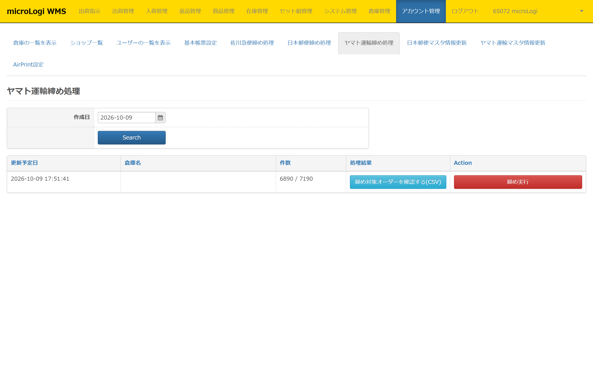

ヤマト運輸締め処理では、ヤマト運輸システムに取り込む（送信する）締めデータの作成・荷物受渡し書を発行できます。

本ページでは、以下について記載します。

-   [**ヤマト運輸締め処理　事前設定**](#h_01FWZKHVW7FV5ZX44MXF685GSQ)
-   [**ヤマト運輸締め処理　検索項目について**](#h_01FWZNWAEQREPQXKKGTTMS23Z4)
-   [**ヤマト運輸締め処理　表示項目について**](#h_01FW6MYHV8AT7HAP6CGJRZZGWZ)
-   [**ヤマト運輸締め処理　締め対象注文条件**](#h_01FWZFDDNZK4R1T3BT8769PVC6)
-   [**ヤマト運輸締め処理　締め実行方法**](#h_01FWZEJ14F91QRTHRYASVFNAG5)

<h2 id="h_01FWZKHVW7FV5ZX44MXF685GSQ">ヤマト運輸締め処理　事前設定</h2>

* * *

締め処理を行うために事前に以下設定を行う必要があります。

①　アカウント管理＞倉庫一覧を表示

②　設定を行う倉庫の［**編集**］ボタンをクリック

③　**[ヤマト運輸設定🖊](https://airlogi-help.zendesk.com/hc/ja/articles/4409360621593-%E5%80%89%E5%BA%AB%E3%81%AE%E4%B8%80%E8%A6%A7%E3%82%92%E8%A1%A8%E7%A4%BA#h_01FW6NW0H92DSXV9DZBNMRGSBP)** にて必要事項を入力し［**登録**］をクリック  
└ **発店コード**  
└ **発店名**  
└ **発店電話番号**  
└ **元払い**  
　　　ヤマト運輸さまより配布された元払いの問番枠を入力  
こちらに登録した問い合わせ番号（送り状番号）を該当倉庫に  
紐づく店舗の引当履歴から自動付与します。  
　　**└ FTP ID**　　　 締めデータを送信する際に使用するFTPサーバーへのログインID 　　**└ FTP Password**　　　 上記IDでFTPサーバーへログインする際のパスワード  
　　**└ 取込区分**　　　 「出荷確定データ」か「予約データ」を送信するかを選択

<h2 id="h_01FWZNWAEQREPQXKKGTTMS23Z4">ヤマト運輸締め処理　検索項目について</h2>

* * *

本メニューの検索項目についての説明です。検索項目は以下用途にてご活用ください。

<strong>・締め処理自体を忘れた場合</strong> <strong>・締め処理は行ったがダウンロードを忘れた場合</strong>

締め処理を忘れた場合や、締めCSVのダウンロードを忘れてしまった日で検索すると、  
過去日の締め実行及び、締めCSVのダウンロードが可能です。

<h2 id="h_01FW6MYHV8AT7HAP6CGJRZZGWZ">ヤマト運輸締め処理　表示項目について</h2>

* * *

本メニューの表示項目についての説明です。

#### **・処理時間**

アカウント管理＞ヤマト運輸締め処理画面を開いた時間です。

#### **・倉庫名**

締め処理画面閲覧時のログインユーザーアカウントが紐づく倉庫名が表示されます。  
ユーザーアカウントの紐づけ倉庫名は、**[アカウント管理＞ユーザーの一覧を表示🖊](https://airlogi-help.zendesk.com/hc/ja/articles/4409350592281)** から確認いただけます。

#### **・件数**

ヤマト運輸システムに送信する出荷注文件数です。

#### **・処理結果**

［**締め実行**］**前**に締め対象オーダーの確認用のCSVのダウンロードや、  
［**締め実行**］**後**に締め処理を実行した（ヤマト運輸システムに送信した）注文のデータをCSVでダウンロードできます。

#### **・Action**

ヤマト運輸システムに締めデータを送信するための［**締め実行**］が可能です。

<h2 id="h_01FWZFDDNZK4R1T3BT8769PVC6">ヤマト運輸締め処理　締め対象注文条件</h2>

* * *

締め処理の対象となる注文の条件は以下です。

・梱包ステータス「梱包済み」

・出荷ステータス「出荷済み」（緑の［**済**］は締め実行前、青の［**済**］は締め実行済み）

・出荷日 = 締め実行日

・問い合わせ番号（送り状番号）が存在する  
※**[出荷管理＞引当履歴🖊](https://airlogi-help.zendesk.com/hc/ja/articles/4409179154585)** の［**問い合わせ番号付与**］ボタンから自動付与した注文のみ ※**[出荷完了報告🖊](https://airlogi-help.zendesk.com/hc/ja/articles/4409155156377)** からの問番反映や、手動入力した場合は対象外

<h2 id="h_01FWZEJ14F91QRTHRYASVFNAG5">ヤマト運輸締め処理　締め実行方法</h2>

* * *

締め実行手順について説明します。

①　アカウント管理＞ヤマト運輸締め処理

②　［**締め実行**］ボタンをクリック

③　csvファイル、datファイルが生成されます。