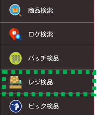
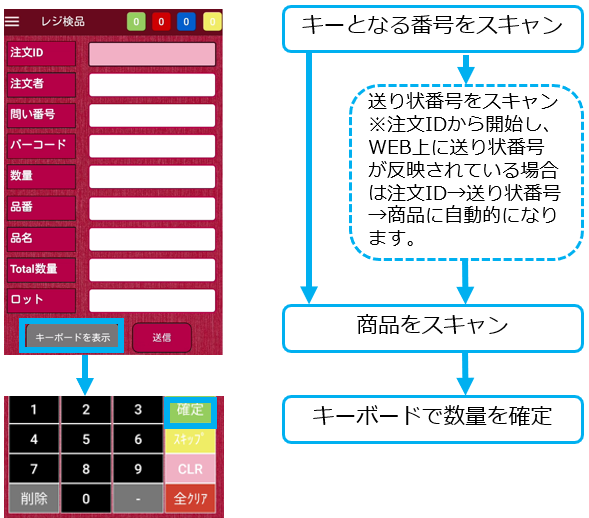
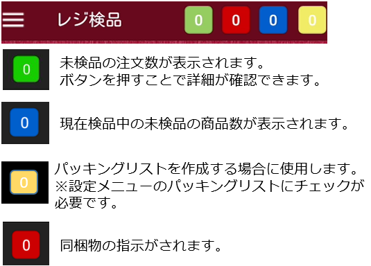
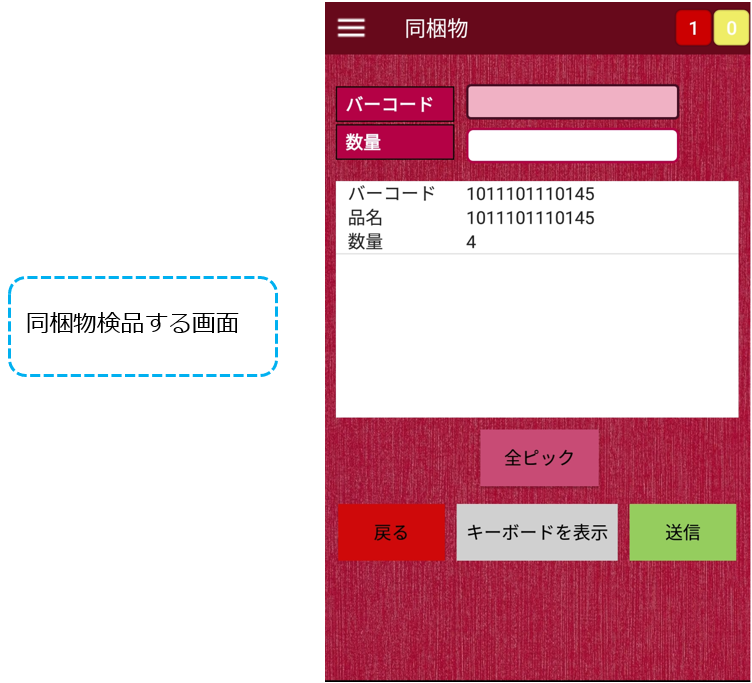

import './style.css';

<h1>出荷検品</h1>

納品書、ピッキングリストで商品をピッキングし、レジ検品を行います。

  YouTube動画はこちらです。

[【クラウドWMS】レジ検品２ ハンディアプリでレジ検品　ピッキング後に誤出荷防止 - YouTube](https://www.youtube.com/watch?v=ItywfoILMXM)

HOME画面の検品オプションでスタートするキーを選択し、レジ検品を行います。

スタートするキーの選択については **[こちら](https://airlogi-help.zendesk.com/hc/ja/articles/4411534839961)** をご参照ください。

①メニューのレジ検品をタップ

②納品書の注文ID、送り状番号から出荷検品

明細行単位での消込になります。 検品途中でクリアをされた場合は次回は途中の残りから検品可能です。 初めから検品し直す場合はキーボードの全クリアボタンを押して下さい。 （レジ検品でスキップ機能はございません。）

右上のボックス内数字については以下の通りです。  
※緑の未検品数が表示されるボックスは引当日が当日の件数のみが表示されます。

★ショップ設定で[【無限在庫の出荷検品】で【対象外】](https://airlogi-help.zendesk.com/hc/ja/articles/%E3%83%AA%E3%83%B3%E3%82%AF%E3%81%AE%E6%8C%BF%E5%85%A5/%E7%B7%A8%E9%9B%86%20#h_01FW8JH4FP4XMJM60NAF96W6X4)を選択されており

　商品マスタで **[在庫管理しない](#h_01FNND46NQN4MX04XMK1K7PXNA)品番のみ** の注文の場合

　⇒　検品はできません。　レジ検品（no recoad found)　ピッキング検品(No data found)

　\*在庫管理しない品番と在庫管理する品番が混在する場合は検品可能です。
