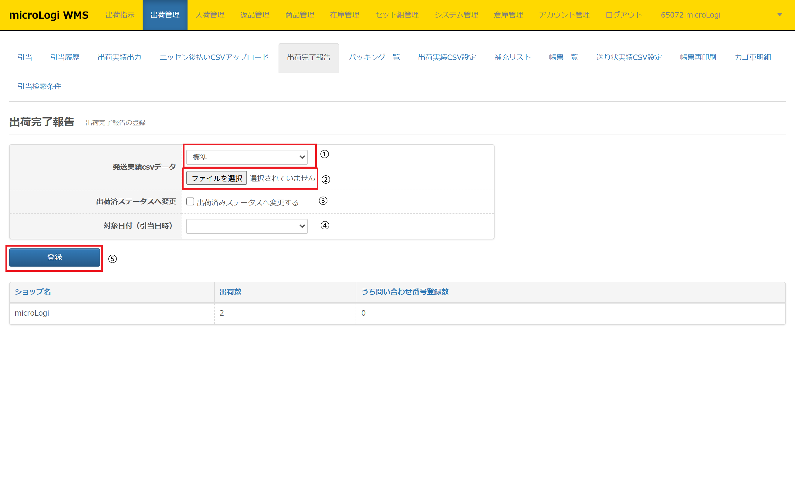
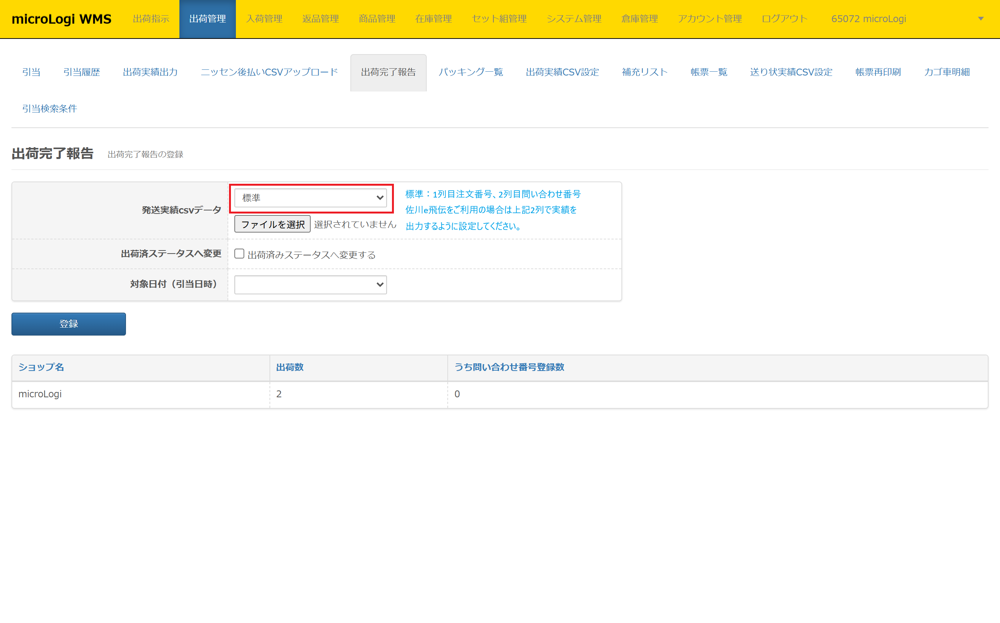
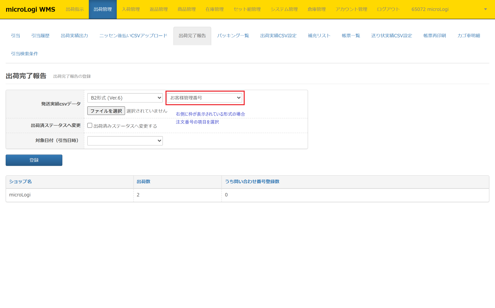
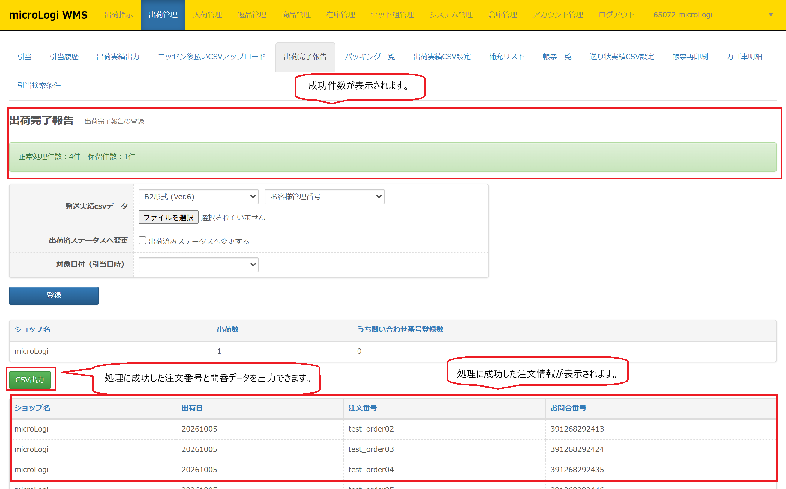
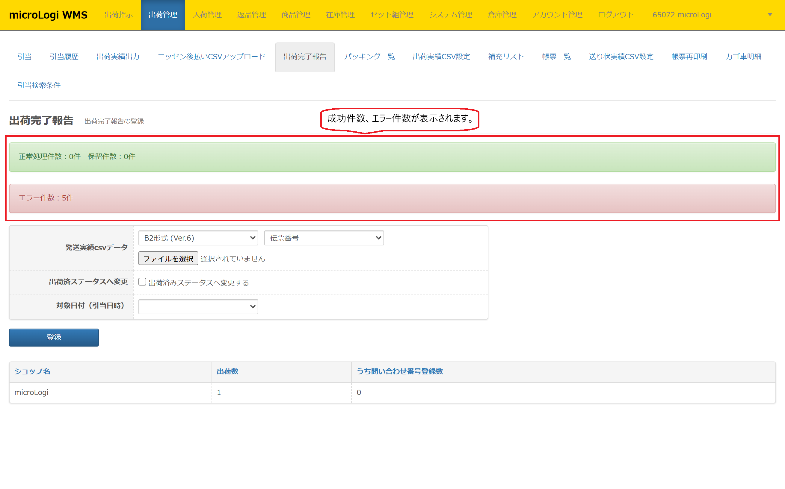

出荷完了報告では、各配送会社のシステムにて発番したお問い合わせ番号（送り状番号）を microLogi内の注文に反映させます。

## 出荷完了報告の利用タイミング

* * *

出荷完了報告にて問い合わせ番号（送り状番号）を反映させるタイミングは2種類です。倉庫の運用方法によりご判断ください。

### ・引当後、出荷作業前

【 フロー 】 引当 → 送り状CSV出力 → 送り状システム → 出荷完了報告 → 各帳票発行 → 帳合 → 出荷

　　上記タイミングにてmicroLogiに問い合わせ番号（送り状番号）を反映させることによって、

　　**ピッキングリストに問い合わせ番号（送り状番号）を出力させることができます。**

　　納品書・ピッキングリストと、送り状の帳合作業を「問い合わせ番号（送り状番号）」を

　   もとに行う場合は上記フローご活用ください。
 
### ・出荷作業後

【 フロー 】
引当 → 送り状CSV出力 → 送り状システム → 送り状発行 → microLogiから各帳票発行 → 帳合 → 出荷 → 出荷完了報告

　　上記タイミングにてmicroLogiに問い合わせ番号（送り状番号）を反映させることによって、

　　**出荷完了報告と同時に「出荷済みステータスへの変更」をまとめて行うことができます。**

　　目視にて納品書・ピッキングリストと、送り状を帳合する運用の場合には上記フローをご活用ください。

## 出荷完了報告　登録方法

* * *

出荷完了報告では以下手順にて問い合わせ番号（送り状番号）をmicroLogiに登録します。

**標準の場合**

**その他（例：ヤマトB2Ver.6）の場合**

①　出荷管理＞出荷完了報告

②　以下項目を選択し［**登録**］をクリック

　　- **発送実績CSVデータ　　　：**「取込み口の形式」「CSVファイル」を選択  
　　　　　　　　　　　　　　　  プルダウンから取込み形式を選択

　　- **出荷済みステータスへ変更：**「出荷済みステータスへ変更する」にチェックを付けて［登録］ボタンを押下すると、  
　　　　　　　　　　　　　　　　問い合わせ番号（送り状番号）の反映と同時に注文のステータスを「出荷済み」に変更することができます。

　　- **対象日付（引当日時）　　：** プルダウンから選択した引当日時の注文に対してのみ問い合わせ番号（送り状番号）を  
　　　　　　　　　　　　　　　　反映させる際に選択します。

## 処理成功の場合

* * *

出荷登録で処理が成功すると以下の画面になります。

#### ・**処理状況についてのメッセージ**

　　「正常処理件数」「保留件数」が表示されます。

#### ・**正常処理注文内容**

　　正常処理された注文の件数と、問い合わせ番号登録件数が表示されます。  
　　正常登録された注文は［**CSV出力**］から  
　　「出荷日」「注文番号」「問い合わせ番号」のデータをダウンロードすることもできます。

#### ・**問い合わせ番号未更新の注文内容**

　　microLogi内の他店舗アカウントにて同一注文番号が存在した場合、問い合わせ番号の更新がなされず、  
　　こちらのリストに表示されます。

#### ・**発送確認メール送信**

　　システム管理＞出荷メール設定にてテンプレートを作成している場合、

　　microLogiから出荷完了メールを注文者様に送信することができます。

　
## 処理失敗の場合

* * *

出荷登録で処理が失敗すると以下の画面になります。

#### ・**処理状況についてのメッセージ**

　　「正常処理件数」「保留件数」「エラー件数」が表示されます。

#### ・**正常処理注文内容**

　　正常処理された注文の件数と、問い合わせ番号登録件数が表示されます。  
　　正常登録された注文は［**CSV出力**］から  
　　「出荷日」「注文番号」「問い合わせ番号」のデータをダウンロードすることもできます。

#### ・**問い合わせ番号未更新の注文内容**

　　microLogi内の他店舗アカウントにて同一注文番号が存在した場合、問い合わせ番号の更新がなされず、  
　　こちらのリストに表示されます。

#### ・**発送確認メール送信**

　　システム管理＞出荷メール設定にてテンプレートを作成している場合、

　　microLogiから出荷完了メールを注文者様に送信することができます。

　　