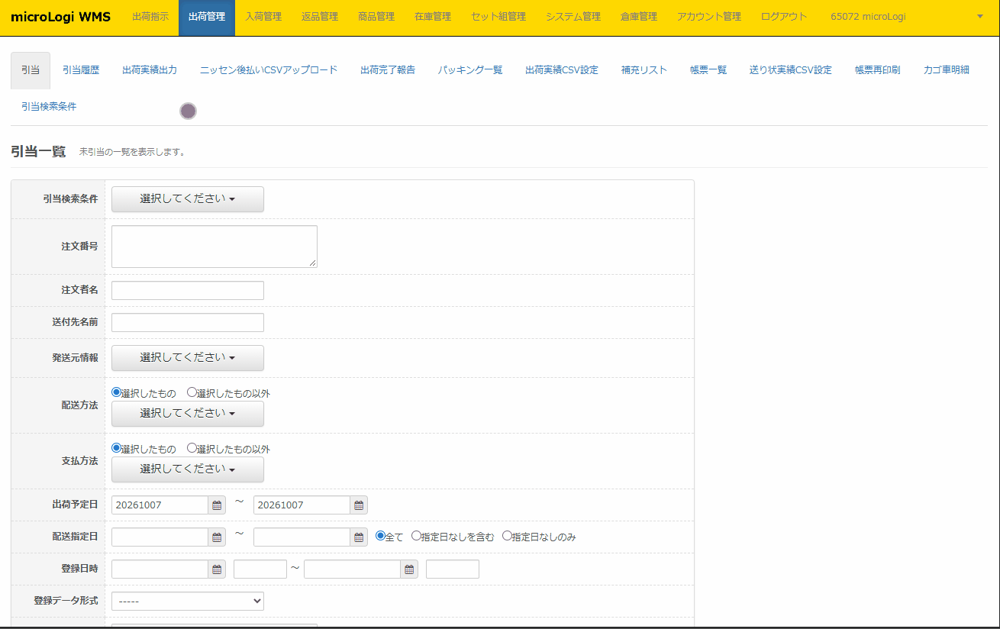
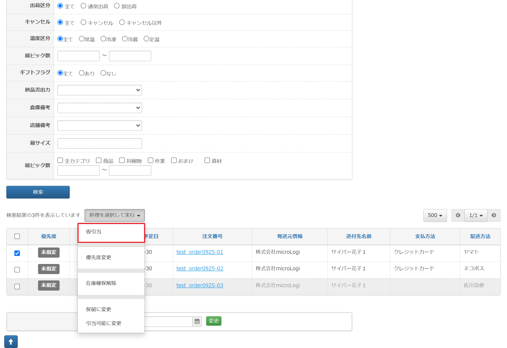
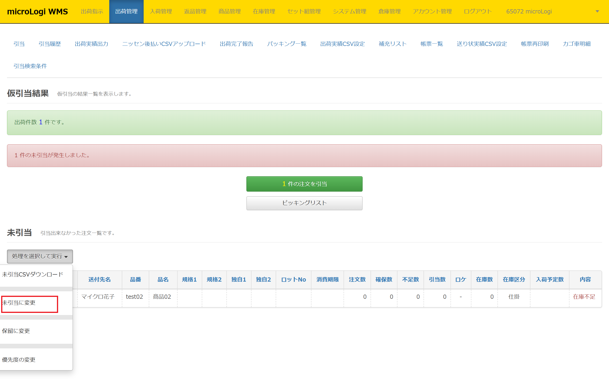
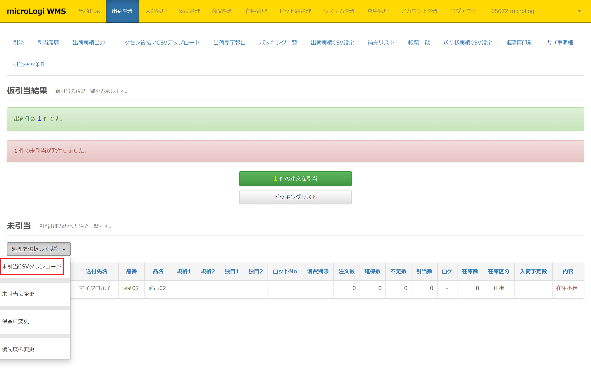
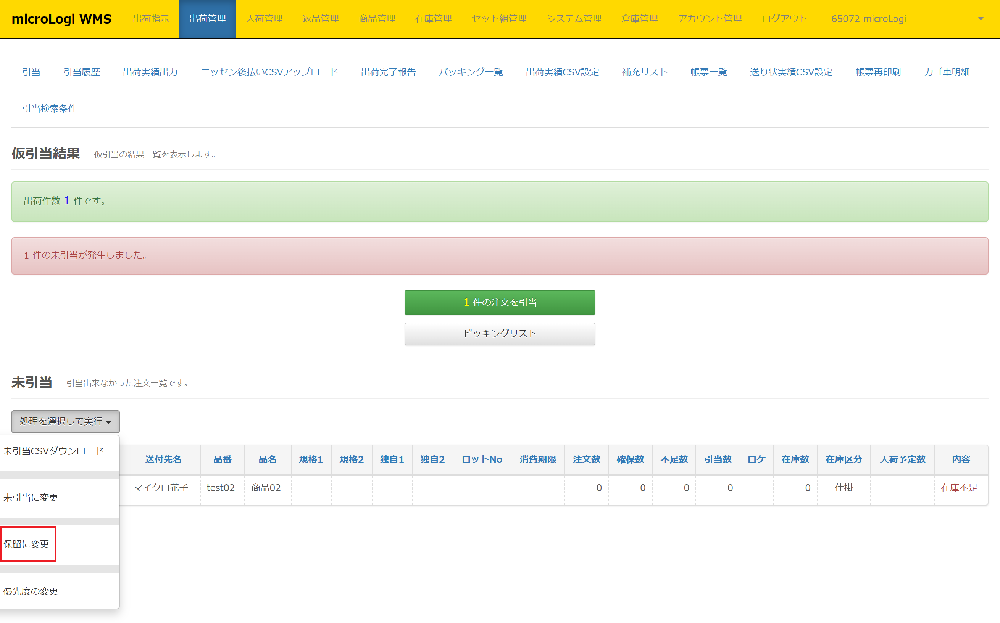
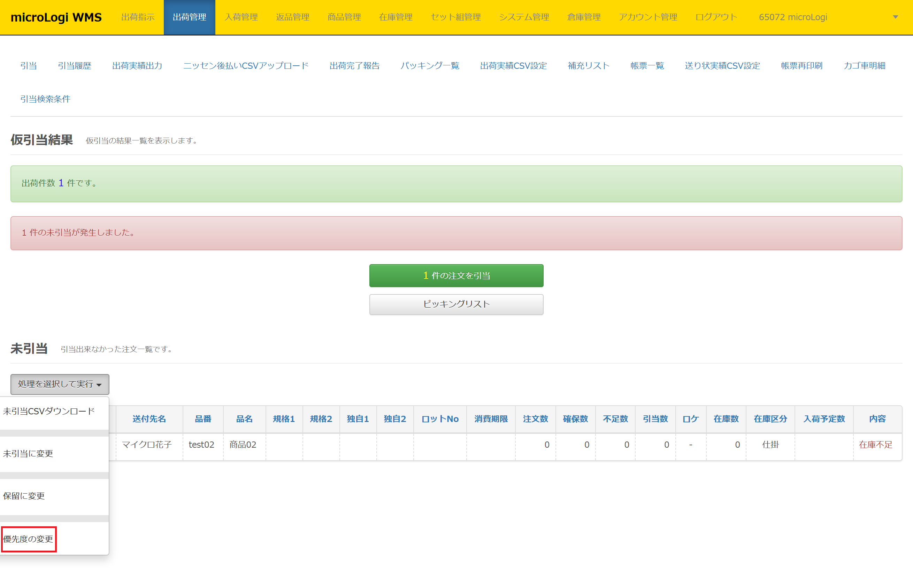
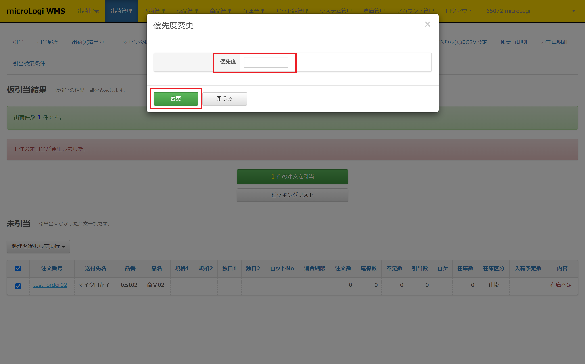
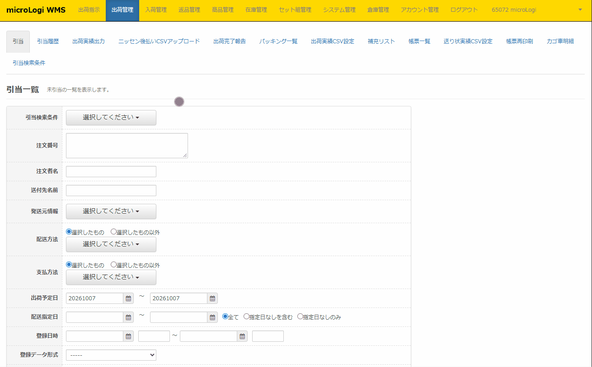
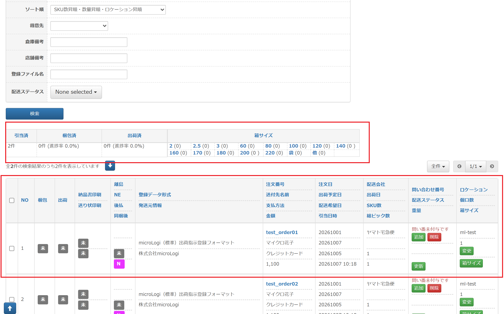

引当では、microLogiに取り込んだ注文商品の引当作業を行います。未引当が発生した場合、注文分割や在庫確保処理や、未引当リストの出力などが可能です。

  

## 引当メニューについて

***

仮引当中にタブの複製を行わないでください。引当ロックがかかり、引当ができなくなります。 仮引当をする際には、編集中の注文は必ず閉じてください。

  

-   引当一覧に表示されている注文は、出荷予定日：当日日付がデフォルトです。
-   引当一覧から「配送方法」や「支払方法」「品番」などで絞り込み検索し引当可能です。
-   デフォルトは500件表示になっていますが50～全件等表示件数を変更できます。

## 仮引当

***

システム上に在庫があるかを確認します。

仮引当中にタブの複製を行わないでください。引当ロックがかかり、引当ができなくなります。 

  

① 出荷管理＞引当

② 引当を行う注文の条件を選択、入力し［**検索**］をクリック

③ 引当を行う注文の左横チェックボックスにチェック

④ ［処理を選択して実行］の［仮引当］をクリック

## 仮引当結果 - 本引当
***

仮引当を行うと仮引当結果が表示されます。 本引当を行い、在庫減算及び出荷作業に移ります。

① 出荷管理＞引当

② 引当を行う注文の条件を選択、入力し［**検索**］をクリック

③ 引当を行う注文の左横チェックボックスにチェック

④ ［処理を選択して実行］の［仮引当］をクリック

⑤ ④を行うと仮引当結果が表示されます。

⑥ 画面中央緑の【 **〇件の注文を引当** 】ボタンをクリック

## 仮引当結果 - 未引当への変更方法

***

注文のステータスを未引当に変更します。

① 出荷管理＞引当

② 引当を行う注文の条件を選択、入力し［**検索**］をクリック

③ 引当を行う注文の左横チェックボックスにチェック

④ ［処理を選択して実行］の［仮引当］をクリック

⑤ ④を行うと仮引当結果が表示されます。

⑥ 未引当となった注文の左横チェックボックスにチェック

⑦ ［処理を選択して実行］の［未引当に変更］をクリック

## 仮引当結果 - 未引当リスト出力方法

***

未引当注文の未引当リストをダウンロードできます。

① 出荷管理＞引当

② 引当を行う注文の条件を選択、入力し［**検索**］をクリック

③ 引当を行う注文の左横チェックボックスにチェック

④ ［処理を選択して実行］の［仮引当］をクリック

⑤ ④を行うと仮引当結果が表示されます。

⑥ 未引当となった注文の左横チェックボックスにチェック

⑦ ［処理を選択して実行］の［未引当CSVダウンロード］をクリック

⑧ 以下未引当リストが出力できます。

<table border="1" style={{ width: '100%', display: 'table' }}>
  <tbody>
    <tr style={{ verticalAlign: 'middle' }}>
      <td style={{ width: '10%', textAlign: 'center' }}><strong>列番号</strong></td>
      <td style={{ width: '30%' }}><strong>&nbsp;未引当CSV 出力項目</strong></td>
      <td style={{ width: '60%' }}><strong>&nbsp;未引当CSV 出力内容</strong></td>
    </tr>
    <tr style={{ verticalAlign: 'middle' }}>
      <td style={{ textAlign: 'center' }}>1</td>
      <td>&nbsp;注文番号</td>
      <td>&nbsp;未引当の注文番号が出力されます</td>
    </tr>
    <tr style={{ verticalAlign: 'middle' }}>
      <td style={{ textAlign: 'center' }}>2</td>
      <td>&nbsp;出荷予定日</td>
      <td>&nbsp;未引当の注文の出荷予定日が出力されます</td>
    </tr>
    <tr style={{ verticalAlign: 'middle' }}>
      <td style={{ textAlign: 'center' }}>3</td>
      <td>&nbsp;取込形式</td>
      <td>&nbsp;未引当の注文が取り込まれた形式が出力されます &nbsp;例：個別入力、標準EDI etc...</td>
    </tr>
    <tr style={{ verticalAlign: 'middle' }}>
      <td style={{ textAlign: 'center' }}>4</td>
      <td>&nbsp;注文者</td>
      <td>&nbsp;未引当の注文の注文者名が出力されます</td>
    </tr>
    <tr style={{ verticalAlign: 'middle' }}>
      <td style={{ textAlign: 'center' }}>5</td>
      <td>&nbsp;品番</td>
      <td>&nbsp;未引当の原因の品番が出力されます</td>
    </tr>
    <tr style={{ verticalAlign: 'middle' }}>
      <td style={{ textAlign: 'center' }}>6</td>
      <td>&nbsp;品名</td>
      <td>&nbsp;未引当の原因の品番の商品名が出力されます</td>
    </tr>
    <tr style={{ verticalAlign: 'middle' }}>
      <td style={{ textAlign: 'center' }}>7</td>
      <td>&nbsp;規格1</td>
      <td>&nbsp;商品マスタの規格1が出力されます</td>
    </tr>
    <tr style={{ verticalAlign: 'middle' }}>
      <td style={{ textAlign: 'center' }}>8</td>
      <td>&nbsp;規格2</td>
      <td>&nbsp;商品マスタの規格2が出力されます</td>
    </tr>
    <tr style={{ verticalAlign: 'middle' }}>
      <td style={{ textAlign: 'center' }}>9</td>
      <td>&nbsp;独自1</td>
      <td>&nbsp;商品マスタの独自1が出力されます</td>
    </tr>
    <tr style={{ verticalAlign: 'middle' }}>
      <td style={{ textAlign: 'center' }}>10</td>
      <td>&nbsp;独自2</td>
      <td>&nbsp;商品マスタの独自2が出力されます</td>
    </tr>
    <tr style={{ verticalAlign: 'middle' }}>
      <td style={{ textAlign: 'center' }}>11</td>
      <td>&nbsp;注文数</td>
      <td>&nbsp;未引当の原因の品番の購入点数を出力します</td>
    </tr>
    <tr style={{ verticalAlign: 'middle' }}>
      <td style={{ textAlign: 'center' }}>12</td>
      <td>&nbsp;在庫区分在庫数</td>
      <td>&nbsp;該当の在庫区分の在庫数 ※開発部確認中※</td>
    </tr>
    <tr style={{ verticalAlign: 'middle' }}>
      <td style={{ textAlign: 'center' }}>13</td>
      <td>&nbsp;不足数</td>
      <td>&nbsp;引当に不足している数</td>
    </tr>
    <tr style={{ verticalAlign: 'middle' }}>
      <td style={{ textAlign: 'center' }}>14</td>
      <td>&nbsp;在庫区分</td>
      <td>&nbsp;引当を試行した在庫区分</td>
    </tr>
    <tr style={{ verticalAlign: 'middle' }}>
      <td style={{ textAlign: 'center' }}>15</td>
      <td>&nbsp;商品在庫数</td>
      <td>&nbsp;未引当の原因品番のシステム全体の商品総在庫数</td>
    </tr>
    <tr style={{ verticalAlign: 'middle' }}>
      <td style={{ textAlign: 'center' }}>16</td>
      <td>&nbsp;メモ</td>
      <td>&nbsp;仮引当結果画面の未引当の内容が出力されます</td>
    </tr>
    <tr style={{ verticalAlign: 'middle' }}>
      <td style={{ textAlign: 'center' }}>17</td>
      <td>&nbsp;ロットNo</td>
      <td>&nbsp;在庫にロットを登録している場合は &nbsp;引当を試行したロットNoが出力されます</td>
    </tr>
  </tbody>
</table>

## 仮引当結果 - 保留への変更方法

***

未引当注文を引当がされないよう、保留ステータスに変更します。

  
## 仮引当結果 - 引当優先順の変更方法

***

未引当注文の引当優先順を変更します。

未指定、最優先、優先高、優先中、優先低を指定できます。デフォルトは未指定です。

 「5」→「最優先」

 「4」→「優先度高」

 「3」→「優先度中」

 「2」→「優先度低」

## 仮引当結果 - 在庫確保方法

***

複数SKUを注文している未引当注文のうち、在庫が存在する商品を確保します。  
未引当の原因が解消され次第、確保していた在庫を優先して該当注文に引当させることが可能です。

事前に[アカウント管理＞ショップ一覧🖊](../05-settings/ショップ一覧.md)にて在庫を確保する設定に変更する必要があります。 在庫分割と在庫確保は、同時に有効化できる機能ではありません。どちらを利用するかは運用によりご判断ください。

 

① 出荷管理＞引当

② 引当を行う注文の条件を選択、入力し［**検索**］をクリック

③ 引当を行う注文の左横チェックボックスにチェック

④ ［処理を選択して実行］の［仮引当］をクリック

⑤ ④を行うと仮引当結果が表示されます。

⑥ 在庫確保を行う未引当注文の左横チェックボックスにチェック

⑦ ［**○件の注文を引当 ○件の注文を在庫確保**］をクリック

⑧ 何も表示されませんが、在庫確保した注文のステータスが「**在庫確保**」に変更されます。

## 仮引当結果 - 注文分割方法

***

複数SKUを注文している未引当注文のうち、引当が可能な商品と未引当の原因となっている商品で注文を分割します。

[事前にアカウント管理＞ショップ一覧🖊](../05-settings/ショップ一覧.md)にて在庫分割する設定に変更する必要があります。 在庫分割と在庫確保は、同時に有効化できる機能ではありません。どちらを利用するかは運用によりご判断ください。

 
① 出荷管理＞引当

② 引当を行う注文の条件を選択、入力し［**検索**］をクリック

③ 引当を行う注文の左横チェックボックスにチェック

④ ［処理を選択して実行］の［仮引当］をクリック

⑤ ④を行うと仮引当結果が表示されます。

⑥ 在庫分割を行う未引当注文の左横チェックボックスにチェック

⑦ ［**○件の注文を引当 ○件の注文を在庫分割**］をクリック

## 引当結果について

***

正常に引当できたデータは[引当履歴画面🖊](引当履歴.md)で確認できます。

[引当履歴🖊](引当履歴.md)で様々な検索条件で絞り込むことが可能です。

配送会社が複数ある場合には配送会社ごとに絞りこみ送り状CSVを出力します。