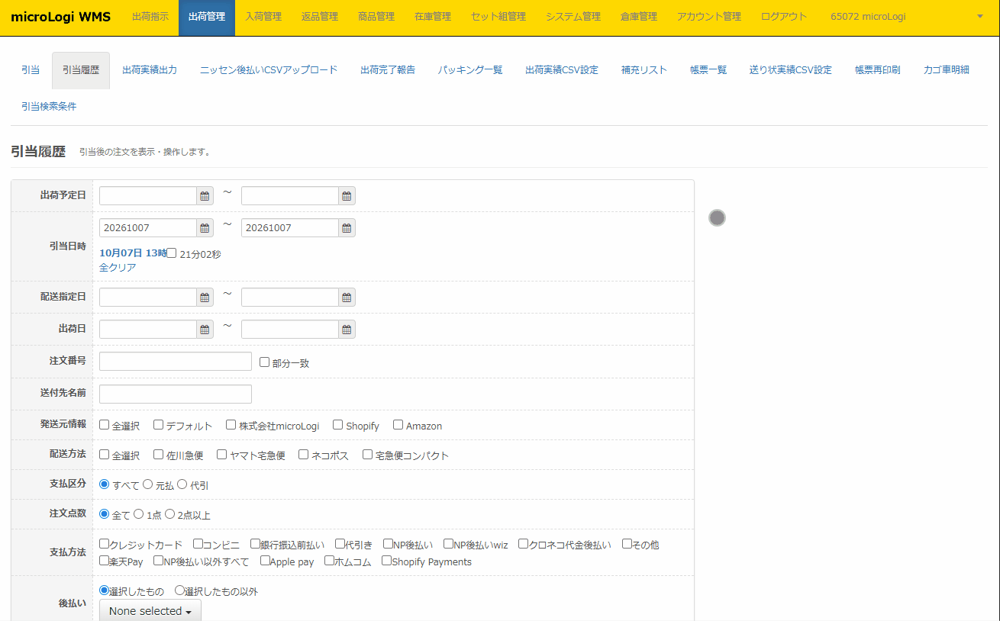

引当履歴では、引当を行った注文の確認や、出荷作業に必要な帳票発行・送り状CSVを出力を行います。

以下項目は、【倉庫スタッフ】【倉庫管理者】権限のアカウントでログインされている方のみ

操作が可能となります。

【店舗スタッフ】権限では、表示されません。

・引当前戻し

・送り状CSV出力

・トータルピッキングリスト出力

・再出荷指示

・クロネコ代金後払い並び替え

・バーコードダウンロード

・のし印刷

・メッセージカード印刷

   

引当履歴画面では以下操作が可能です。※以下操作は引き当てた注文が存在する場合にのみ可能です。

・**各種ステータス変更**　詳細は[**こちらから✍**](<-引当履歴　各種ステータス変更.md>)

・**重量、箱サイズの一括入力**　詳細は[**こちらから✍**](<-引当履歴　重量、箱サイズの一括入力.md>)

・**問番付与、削除**　詳細は[**こちらから✍**](<-引当履歴　問番付与、削除.md>)

・**各種日付の変更、配送方法変更**　詳細は[**こちらから✍**](<-引当履歴　各種ステータス変更.md>)

・**各帳票発行**　詳細は[**こちらから✍**](<-引当履歴　各帳票発行.md>)

・**引当前戻し**　詳細は[**こちらから✍**](<-引当履歴　引当前戻し.md>)