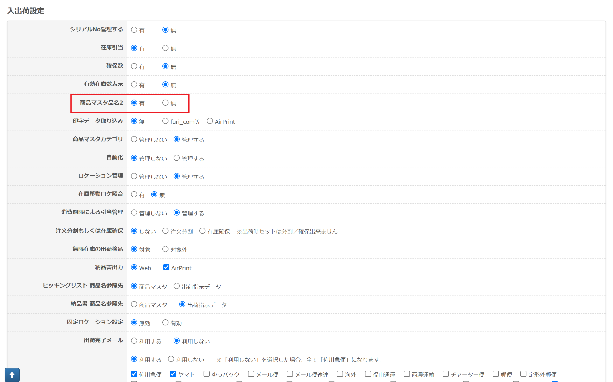
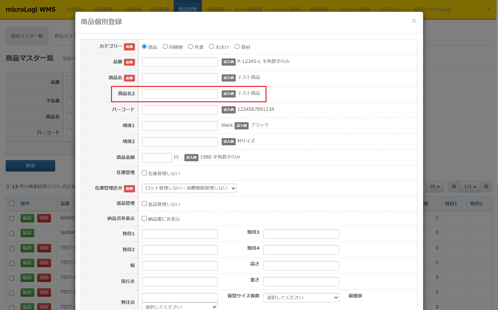

# 【品名２】商品マスタ品名２は何に使えますか？

---

> ***Q:***
> 
> ***商品マスタに登録できる「商品名2」について教えてください。***
> 
> ***A:***
> 
> ***アカウント管理＞ショップ一覧から商品名2の機能を有効していなければ***  
> ***microLogi の商品マスタに「商品名2」を登録することはできません。***
> 
> *商品マスタの商品名2に登録がある商品が、注文の商品明細に含まれる場合、*  
> *商品名2が送り状の品名欄に優先して出力されます。*
> 
> *商品名2が存在する商品が複数あり、文言が異なる場合はそれぞれ出力されます。*  
> *商品名2が存在しない商品のみを注文している場合は、ショップ一覧の「品名1」が出力されます。*
>
>
> ***本機能は、microLogiから直発行する送り状一体型***  
> ***(ヤマト宅急便、ゆうパック、ゆうパケット)のみに対応しています。***  
> ***※送り状CSVには対応していません。***
>
>
>
> ***利用方法***
>
>---
>
> *商品名2を利用する場合は、ショップ一覧の「入出荷設定で商品マスタ品名2」を「有」に変更ください。*
>
>---
>
>
> *商品マスタの「商品名2」の項目に登録してください。*  
> *※CSVでの一括登録は対応できません。*
>
> **商品個別登録**
>