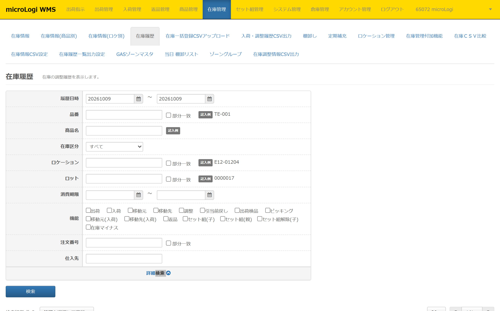
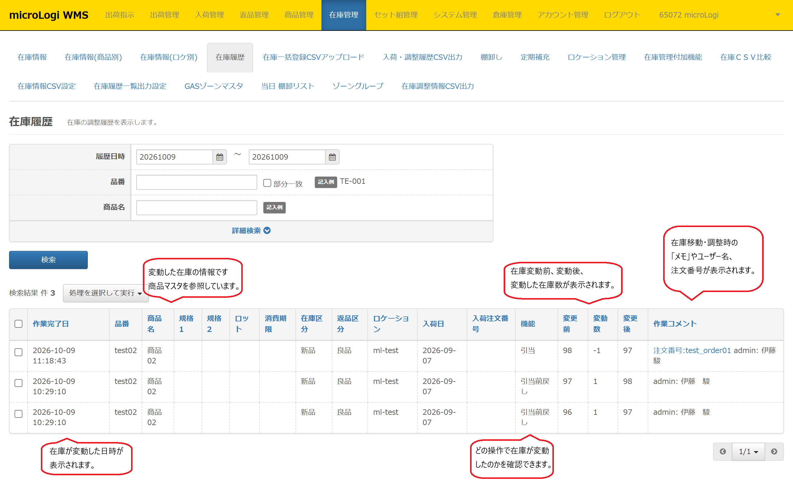
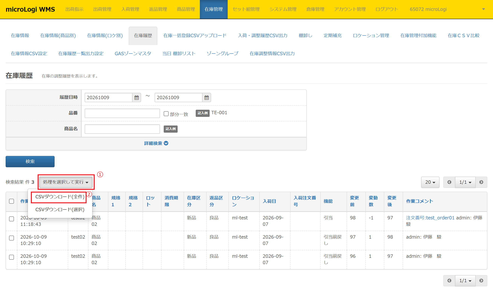
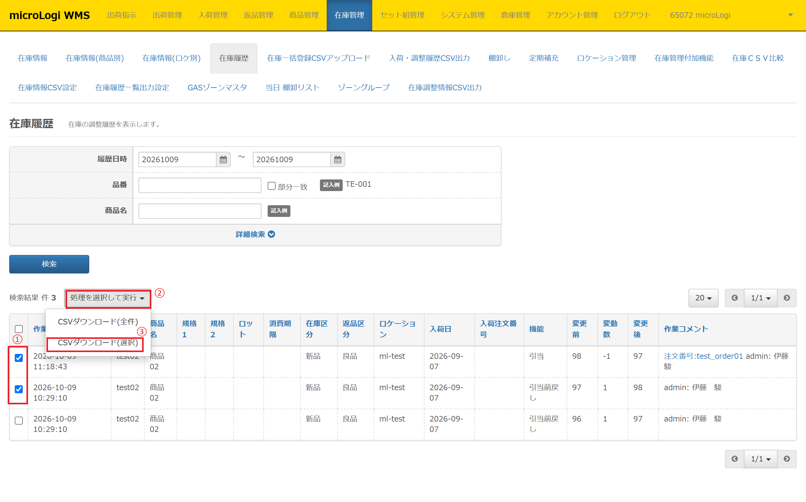

在庫履歴では、在庫の変動履歴の確認、在庫履歴データのダウンロードができます。

本記事では、以下について記載いたします。

-   **[在庫履歴　検索項目](#h_01FPCCMFFG96TW6QPP1KQA0N0H)**
-   **[在庫履歴　表示項目](#h_01FWGFV6NSQP6ZDPRW42A4WCB0)**
-   [**在庫履歴　機能とは？**](#h_01FWGFV6NSQP6ZDPRW42A4WAE0)
-   **[在庫履歴　CSV出力方法](#h_01FPCDF78NTJP3BN2WS88GM0PA)**

<h2 id="h_01FPCCMFFG96TW6QPP1KQA0N0H">在庫履歴　検索項目</h2>

* * *

各検索項目の詳細内容です。

<h4>・履歴日時</h4>

範囲指定した期間の在庫履歴を検索できます。※最大検索範囲60日

<h4>・品番</h4>

部分一致にて特定の品番の在庫履歴を検索できます。

<h4>・商品名</h4>

部分一致にて特定の商品名の在庫履歴を検索できます。

<h4>・在庫区分</h4>

「すべて」「新品」「仕掛」にて検索できます。  
**[システム管理＞在庫区分一覧🖊](https://airlogi-help.zendesk.com/hc/ja/articles/4409254333337)** にて在庫区分を独自に作成している場合は  
新規作成した在庫区分もプルダウンから選択し検索可能です。

<h4>・ロケーション</h4>

部分一致にて特定のロケーションの在庫を検索できます。

<h4>・ロット</h4>

部分一致にて特定のロットの在庫を検索できます。

<h4>・消費期限</h4>

範囲指定した消費期限の在庫履歴を検索できます。※範囲指定の上限なし

<h4>・機能</h4>

在庫変動が発生する各機能にて絞込検索が可能です。各機能の詳細は **[こちら🖊](#h_01FWGFV6NSQP6ZDPRW42A4WAE0)** から確認いただけます。

<h4>・注文番号</h4>

部分一致にて特定の注文番号の在庫履歴を検索できます。

<h4>・仕入先</h4>

入荷指示で入力した仕入先での絞り込み検索ができます。

<h2 id="h_01FWGFV6NSQP6ZDPRW42A4WCB0">在庫履歴　表示項目</h2>

* * *

各表示項目の詳細内容です。

<h4>・作業完了日</h4>

検索項目でいうところの「履歴日時」です。在庫が変動した日時が表示されます。

<h4>・品番</h4>

在庫変動した品番が表示されます。

<h4>・商品名</h4>

在庫変動した品番の商品名が表示されます。  
商品マスタの商品名を参照しているため、変更すると在庫履歴の表示も変わります。

<h4>・規格1</h4>

在庫変動した品番の規格1が表示されます。  
商品マスタの規格1を参照しているため、変更すると在庫履歴の表示も変わります。

<h4>・規格2</h4>

在庫変動した品番の規格2が表示されます。  
商品マスタの規格2参照しているため、変更すると在庫履歴の表示も変わります。

<h4>・ロット</h4>

在庫変動した在庫のロットが表示されます。  
該当在庫にロットが存在しない場合は表示されません。

<h4>・消費期限</h4>

在庫変動した在庫の消費期限が表示されます。  
該当在庫に消費期限が存在しない場合は表示されません。

<h4>・在庫区分</h4>

在庫変動した在庫の在庫区分が表示されます。

<h4>・返品区分</h4>

基本的に「良品」が固定で表示されています。

<h4>・ロケーション</h4>

在庫変動した在庫のロケーションが表示されます。

<h4>・入荷日</h4>

**[システム管理＞応用設定🖊](https://airlogi-help.zendesk.com/hc/ja/articles/4409279091097--%E5%8B%95%E4%BD%9C%E7%A2%BA%E8%AA%8D%E4%B8%AD-%E5%BF%9C%E7%94%A8%E8%A8%AD%E5%AE%9A#h_01FS9KB1N0G6K0DSH44HCNNF8T)** にて「入荷日管理」を「有」としている場合、入荷日の項目が表示されます。  
在庫変動した在庫の入荷日が表示されます。  
該当在庫に入荷日が存在しない場合は表示されません。

<h4>・機能</h4>

在庫変動が発生した操作内容が表示されます。各機能の詳細は **[こちら🖊](#h_01FWGFV6NSQP6ZDPRW42A4WAE0)** から確認いただけます。

<h4>・変更前</h4>

在庫変動前の在庫数が表示されます。

<h4>・変更数</h4>

変動した在庫数が表示されます。

<h4>・変更後</h4>

在庫変動後の在庫数が表示されます。

<h4>・作業コメント</h4>

在庫移動や在庫調整時の「メモ」に入力した値や、注文番号、  
該当在庫の変動にかかわる操作を行ったユーザー名が表示されます。  
ユーザー名を変更すると、在庫履歴の表示も変わります。

<h2 id="h_01FWGFV6NSQP6ZDPRW42A4WAE0">機能とは？</h2>

* * *

検索項目、及び表示項目の「機能」について記載いたします。

<table border="1" style={{ width: '100%', display: 'table' }}>
  <tbody>
    <tr style={{ verticalAlign: 'middle' }}>
      <td style={{ width: '10%', textAlign: 'center' }}><strong>機能ID</strong></td>
      <td style={{ width: '30%' }}><strong>機能名</strong></td>
      <td style={{ width: '60%' }}><strong>&nbsp;機能詳細</strong></td>
    </tr>
    <tr style={{ verticalAlign: 'middle' }}>
      <td style={{ textAlign: 'center' }}>1</td>
      <td>&nbsp;引当</td>
      <td>&nbsp;引当処理による在庫マイナス履歴が表示されます。 &nbsp;引当処理は、<strong><a href="https://airlogi-help.zendesk.com/hc/ja/articles/4409102744601-%E5%BC%95%E5%BD%93#h_01FVQBC2S90HNQQST936P9KS55" rel="noopener noreferrer">出荷管理＞引当🖊</a></strong>にて実施する本引当処理を指します。</td>
    </tr>
    <tr style={{ verticalAlign: 'middle' }}>
      <td style={{ textAlign: 'center' }}>2</td>
      <td>&nbsp;入荷</td>
      <td>&nbsp;入庫（棚入れ）処理を行った履歴です。 &nbsp;Pickmanでの入庫、AiR Logi管理画面からの入庫、すべて表示されます。</td>
    </tr>
    <tr style={{ verticalAlign: 'middle' }}>
      <td style={{ textAlign: 'center' }}>5</td>
      <td>&nbsp;返品</td>
      <td>&nbsp;<strong><a href="https://airlogi-help.zendesk.com/hc/ja/articles/4409251004569" rel="noopener noreferrer">入荷管理＞返品指示🖊</a></strong>から返品入庫処理された場合、 &nbsp;もしくはPickmanで返品入庫処理を行った履歴です。</td>
    </tr>
    <tr style={{ verticalAlign: 'middle' }}>
      <td style={{ textAlign: 'center' }}>6</td>
      <td>&nbsp;セット組(子)</td>
      <td>&nbsp;</td>
    </tr>
    <tr style={{ verticalAlign: 'middle' }}>
      <td style={{ textAlign: 'center' }}>7</td>
      <td>&nbsp;セット組(親)</td>
      <td>&nbsp;</td>
    </tr>
    <tr style={{ verticalAlign: 'middle' }}>
      <td style={{ textAlign: 'center' }}>12</td>
      <td>&nbsp;移動元</td>
      <td>&nbsp;</td>
    </tr>
    <tr style={{ verticalAlign: 'middle' }}>
      <td style={{ textAlign: 'center' }}>13</td>
      <td>&nbsp;移動先</td>
      <td>&nbsp;</td>
    </tr>
    <tr style={{ verticalAlign: 'middle' }}>
      <td style={{ textAlign: 'center' }}>14</td>
      <td>&nbsp;調整</td>
      <td>&nbsp;<strong><a href="https://airlogi-help.zendesk.com/hc/ja/articles/4409251172761" rel="noopener noreferrer">在庫一括アップロード🖊</a></strong>からの在庫調整、 &nbsp;<strong><a href="https://airlogi-help.zendesk.com/hc/ja/articles/4409244982681" rel="noopener noreferrer">在庫情報(商品別)🖊</a></strong>、<strong><a href="https://airlogi-help.zendesk.com/hc/ja/articles/4409244990233" rel="noopener noreferrer">在庫情報(ロケ別)🖊</a></strong>からの在庫移動・調整の履歴です。</td>
    </tr>
    <tr style={{ verticalAlign: 'middle' }}>
      <td style={{ textAlign: 'center' }}>17</td>
      <td>&nbsp;セット組解除(子)</td>
      <td>&nbsp;</td>
    </tr>
    <tr style={{ verticalAlign: 'middle' }}>
      <td style={{ textAlign: 'center' }}>21</td>
      <td>&nbsp;引当前戻し</td>
      <td>&nbsp;<strong><a href="https://airlogi-help.zendesk.com/hc/ja/articles/4409173542553--%E5%BC%95%E5%BD%93%E5%B1%A5%E6%AD%B4-%E5%BC%95%E5%BD%93%E5%89%8D%E6%88%BB%E3%81%97" rel="noopener noreferrer">引当前戻し処理🖊</a></strong>による在庫変動履歴です。</td>
    </tr>
    <tr style={{ verticalAlign: 'middle' }}>
      <td style={{ textAlign: 'center' }}>22</td>
      <td>&nbsp;出荷検品</td>
      <td>&nbsp;</td>
    </tr>
    <tr style={{ verticalAlign: 'middle' }}>
      <td style={{ textAlign: 'center' }}>24</td>
      <td>&nbsp;移動元(入荷)</td>
      <td>&nbsp;</td>
    </tr>
    <tr style={{ verticalAlign: 'middle' }}>
      <td style={{ textAlign: 'center' }}>25</td>
      <td>&nbsp;移動先(入荷)</td>
      <td>&nbsp;</td>
    </tr>
    <tr style={{ verticalAlign: 'middle' }}>
      <td style={{ textAlign: 'center' }}>32</td>
      <td>&nbsp;ピッキング</td>
      <td>&nbsp;</td>
    </tr>
    <tr style={{ verticalAlign: 'middle' }}>
      <td style={{ textAlign: 'center' }}>79</td>
      <td>&nbsp;在庫マイナス</td>
      <td>&nbsp;</td>
    </tr>
  </tbody>
</table>

<h2 id="h_01FPCDF78NTJP3BN2WS88GM0PA">在庫履歴　CSV出力方法</h2>

* * *

在庫データのCSV出力方法について説明いたします。 在庫履歴では下記データを出力できます。  
在庫履歴から出力するデータレイアウトは **[在庫管理＞在庫履歴一覧出力設定🖊](https://airlogi-help.zendesk.com/hc/ja/articles/4409254258329)** にて自由に作成いただけます。

1.  **[CSVダウンロード(全件)](#h_01FPA23WPPPKZW1F29G041XY8K)**
2.  **[CSVダウンロード(選択)](#h_01FPCE1QTBSATGQVYD2XCZWTTR)**

<h3 id="h_01FPA23WPPPKZW1F29G041XY8K">1. CSVダウンロード(全件)</h3>

①　在庫管理＞在庫履歴

②　［処理を選択して実行］ボタンをクリック

③　「CSVダウンロード(全件)」をクリックしダウンロード

※出力行数制限あり：5万行/回

<h3 id="h_01FPCE1QTBSATGQVYD2XCZWTTR">2. CSVダウンロード(選択)</h3>

①　在庫管理＞在庫履歴

②　ダウンロードしたい品番の左横チェックボックスにチェック

③　［処理を選択して実行］ボタンをクリック

④　「CSVダウンロード(選択)」をクリックしダウンロード