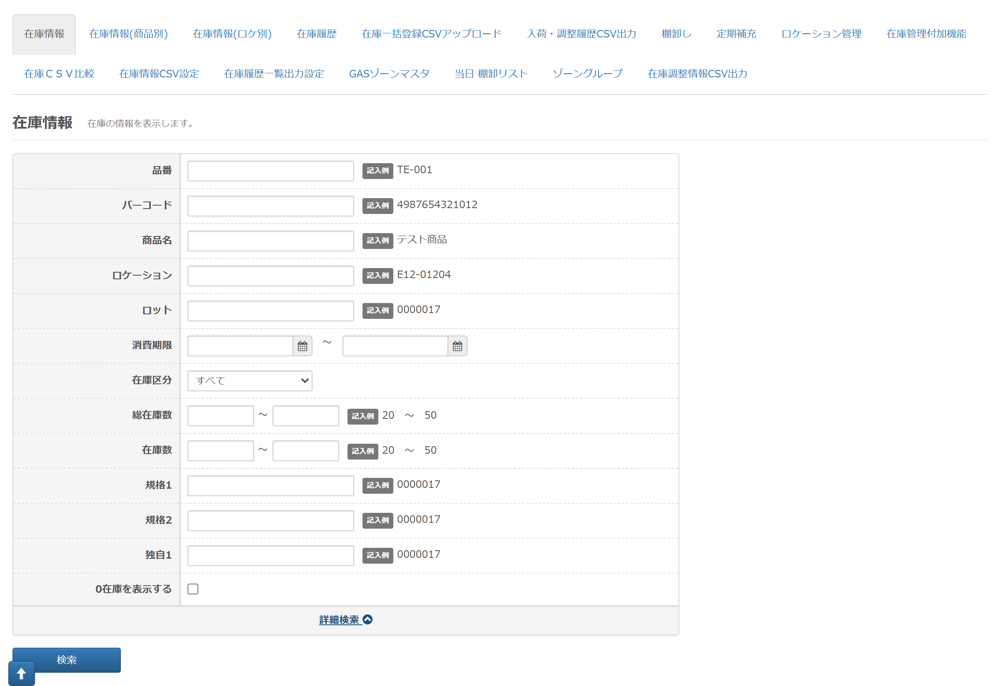
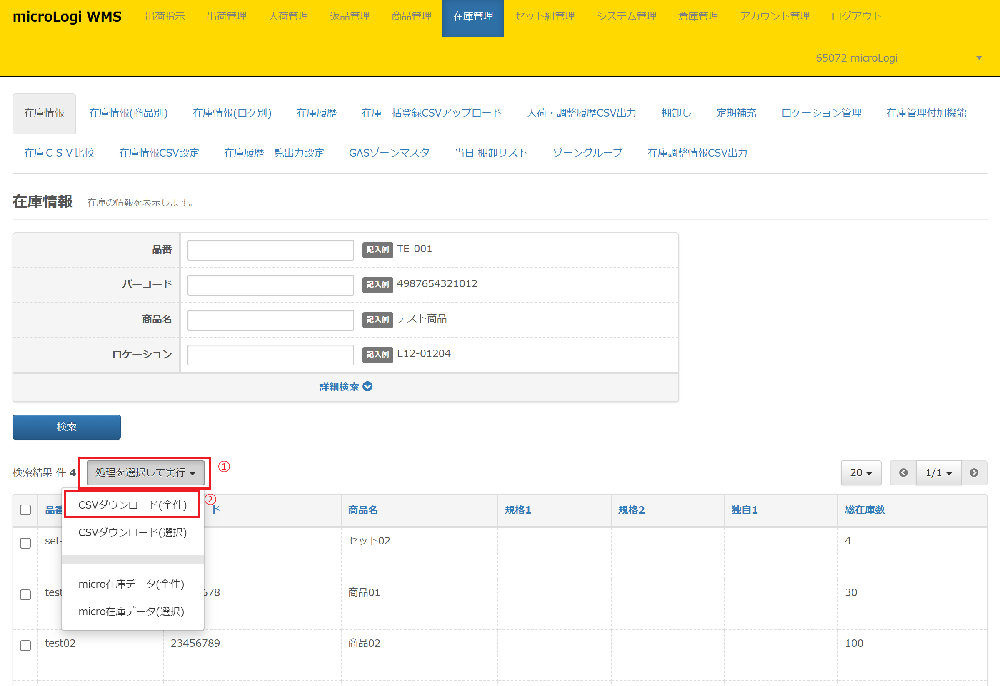

在庫情報では【 総在庫 】情報の確認・在庫データのダウンロードができます。

 
本記事では、以下について記載いたします。

-   [**在庫情報　検索項目**](#h_01FP9ZDX30TA7YVKRH5EMD6053)
-   [**在庫情報　CSV出力方法**](#h_01FP9ZE2AGCMN3CSY3D67960HG)

在庫情報メニューから出力可能なレイアウト作成方法や出力項目については以下をご参照ください。

-   [**在庫情報CSV設定　出力データレイアウト作成方法**](https://airlogi-help.zendesk.com/hc/ja/articles/4409254252313-%E5%9C%A8%E5%BA%AB%E6%83%85%E5%A0%B1CSV%E8%A8%AD%E5%AE%9A#h_01FPYNBG43GYAPYDCE1ZAP383Z)
-   **[在庫情報CSV設定　出力項目](https://airlogi-help.zendesk.com/hc/ja/articles/4409254252313-%E5%9C%A8%E5%BA%AB%E6%83%85%E5%A0%B1CSV%E8%A8%AD%E5%AE%9A#h_01FPYNBNEJA8B88ZA7P9G1WCCA)**

<h2 id="h_01FP9ZDX30TA7YVKRH5EMD6053">在庫情報　検索項目</h2>

* * *

各検索項目の詳細内容です。

<h4>・品番</h4>

部分一致にて特定の品番の在庫を検索できます。

<h4>・バーコード</h4>

部分一致にて特定のバーコードの在庫を検索できます。  
※**[複数バーコード🖊](https://airlogi-help.zendesk.com/hc/ja/articles/4409244968601)** にて登録したバーコードではヒットしません。

<h4>・商品名</h4>

部分一致にて特定の商品名の在庫を検索できます。

<h4>・ロケーション</h4>

在庫情報メニューにはロケーション項目が存在しないため、ご利用いただけません。

<h4>・ロット</h4>

在庫情報メニューにはロット項目が存在しないため、ご利用いただけません。

<h4>・消費期限</h4>

在庫情報メニューには消費期限項目が存在しないため、ご利用いただけません。

<h4>・在庫区分</h4>

在庫情報メニューには在庫区分項目が存在しないため、ご利用いただけません。

<h4>・総在庫数</h4>

在庫に含めない在庫数も含めた総在庫数で検索できます。

<h4>・在庫数</h4>

在庫情報メニューには在庫数項目が存在しないため、ご利用いただけません。

<h4>・規格1</h4>

商品マスタの規格1に登録した値で検索できます。

<h4>・規格2</h4>

商品マスタの規格2に登録した値で検索できます。

<h4>・独自1</h4>

商品マスタの独自1に登録した値で検索できます。

・**0在庫を表示する**

 在庫数が0の在庫を検索結果に表示するか否かを指定できます。  
デフォルトの状態では、0在庫は表示されません。  
（過去に存在していたロットや消費期限等を確認する際にご活用ください）

・**「含めない」在庫区分の在庫数もカウントする**

デフォルトはチェックが入っておりません。

在庫区分で【在庫に含めない】設定をしている在庫区分も含めた在庫数を

表示させたい場合は、チェックを入れてください。

<h2 id="h_01FP9ZE2AGCMN3CSY3D67960HG">在庫情報　CSV出力方法</h2>

* * *

在庫データのCSV出力方法について説明いたします。在庫情報では下記データを出力できます。  
在庫情報から出力するデータレイアウトは[**在庫管理＞在庫情報CSV設定🖊**](https://airlogi-help.zendesk.com/hc/ja/articles/4409254252313)にて自由に作成いただけます。

1.  **[CSVダウンロード(全件)](#h_01FPCE48GKTRZWATA37GJBJE3H)**
2.  **[CSVダウンロード(選択)](#h_01FPCE4H7CXDHVA9FMNF9QWARR)**

<h3 id="h_01FPCE48GKTRZWATA37GJBJE3H">1. CSVダウンロード(全件)</h3>

①　在庫管理＞在庫情報

②　［処理を選択して実行］ボタンをクリック

③　「CSVダウンロード(全件)」をクリックしダウンロード

<h3 id="h_01FPCE4H7CXDHVA9FMNF9QWARR">2. CSVダウンロード(選択)</h3>

①　在庫管理＞在庫情報

②　ダウンロードしたい品番の左横チェックボックスにチェック

③　［処理を選択して実行］ボタンをクリック

④　「CSVダウンロード(選択)」をクリックしダウンロード