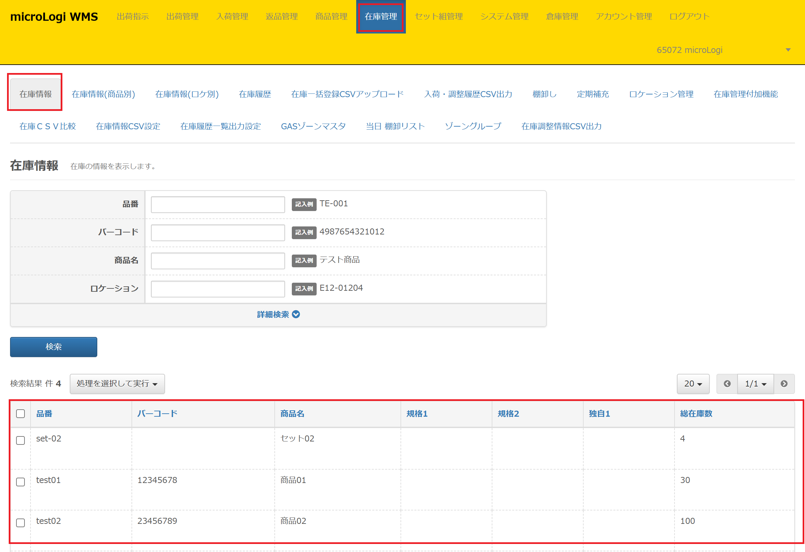
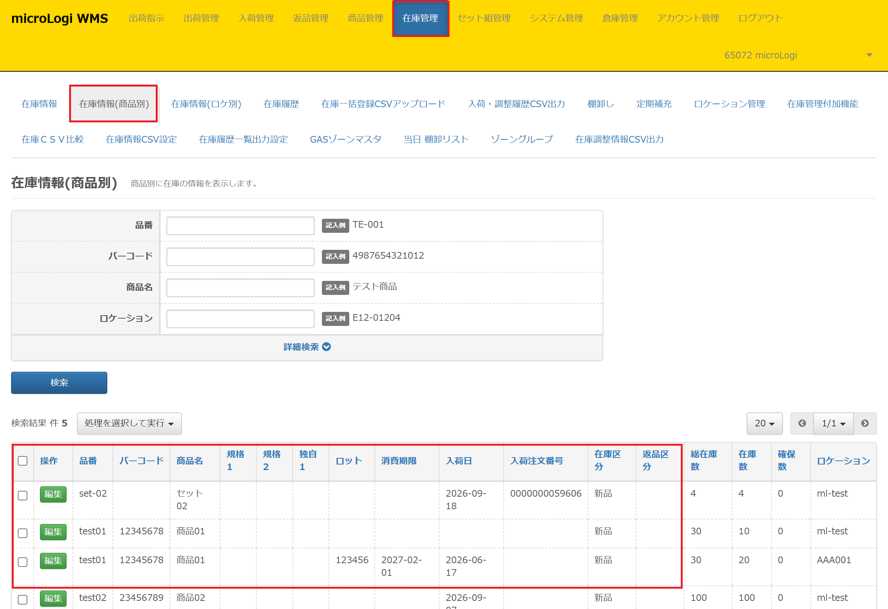
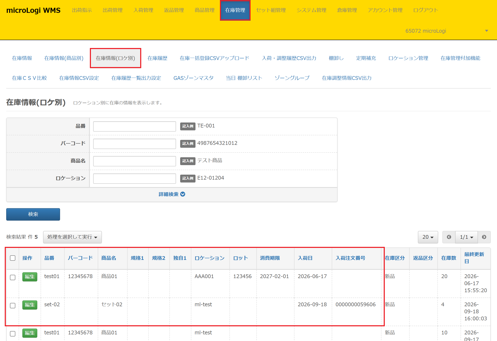
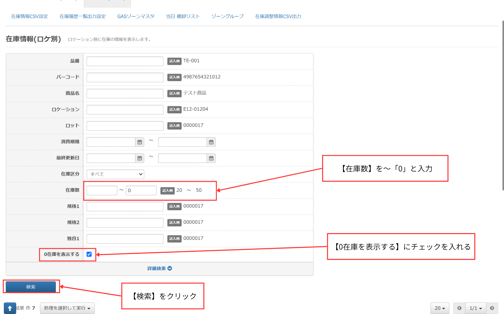

microLogiでは在庫情報を確認するメニューが3つありますが「店舗スタッフ」権限のユーザーアカウントは デフォルトでは「[在庫情報(商品別)](在庫情報【商品別】.md)」「[在庫情報(ロケ別)](在庫情報【ロケ別】.md)」のサブメニューの閲覧権限はありません。 必要な場合は「倉庫管理者」権限のユーザーにてアカウント管理＞ユーザー一覧より「[在庫情報(商品別)](在庫情報【商品別】.md)」「[在庫情報(ロケ別)](在庫情報【ロケ別】.md)」の閲覧権限を付与したいユーザーに権限付与を行ってください。 ※「在庫情報(商品別)」「在庫情報(ロケ別)」では在庫調整や在庫移動が可能です。 閲覧権限を変更する場合は、上記ご留意のうえご判断ください。

## 現在存在する在庫情報を確認する

***

現在存在する在庫は「[在庫情報](在庫情報.md)」「[在庫情報(商品別)](在庫情報【商品別】.md)」「[在庫情報(ロケ別)](在庫情報【ロケ別】.md)」の3つのサブメニューにて確認可能です。

### ・「[在庫情報](在庫情報.md)」で在庫情報を確認する方法

在庫管理＞在庫情報では、SKUごとの総在庫数が確認できます。  
どの商品に対して参照時刻時点、何点の在庫があるかが参照可能です。  
総在庫数は「在庫数に含める」在庫区分が加算された値が表示されています。

### ・「[在庫情報(商品別)](在庫情報【商品別】.md)」で在庫情報を確認する方法

在庫管理＞在庫情報(商品別)では「ロット」「消費期限」「在庫区分」「ロケーション」別の在庫数と  
SKU別の総在庫数を一緒に確認できます。

### ・「[在庫情報(ロケ別)](在庫情報【ロケ別】.md)」で在庫情報を確認する方法

在庫管理＞在庫情報ロケ別では「ロット」「消費期限」「在庫区分」「ロケーション」別の在庫数と  
各在庫数の最終更新日時が確認できます。

## 過去に存在していた在庫情報を確認する

***

過去に存在していた在庫情報は「[在庫情報(ロケ別)](在庫情報【ロケ別】.md)」のサブメニューのみで確認可能です。

① 在庫管理＞在庫情報(ロケ別)の検索項目最下部「詳細検索」をクリック

② 「在庫数」の検索項目にて～「0」と入力

③ 「0在庫を表示する」にチェックをいれる

④ ［検索］ボタンをクリックする

上記の4ステップで過去に在庫は存在していたものの、現在は在庫数が0の在庫情報を確認可能です。