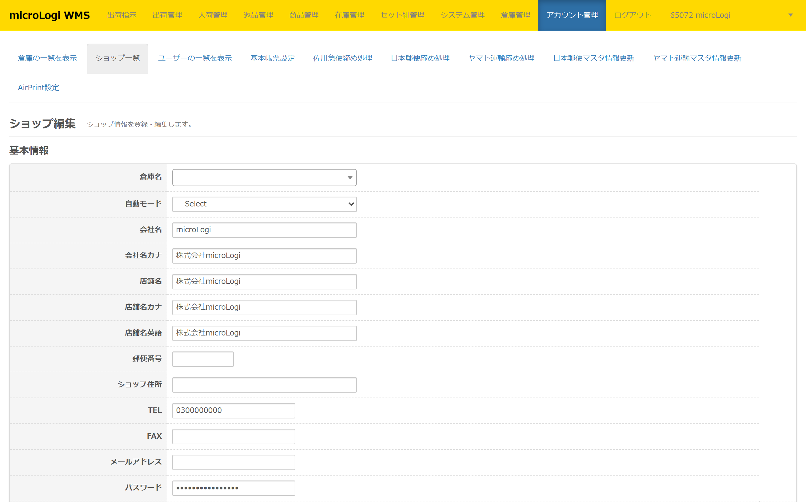
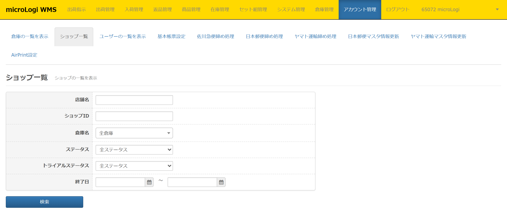
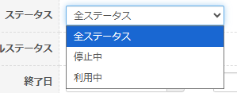
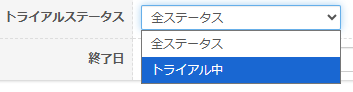
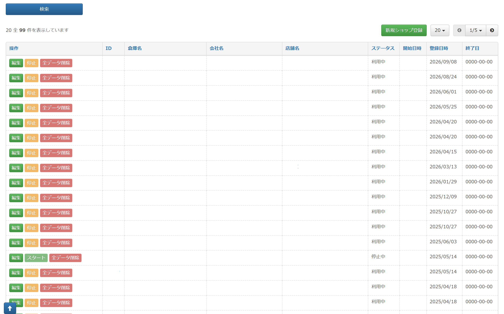

ショップ設定では、基本となるショップ情報の設定を行うことができます。 ユーザー権限が【 倉庫管理者 】でのみ設定が可能です。

## ショップ一覧　設定項目

* * *

ショップ編集画面では以下項目の設定が可能です。詳細は以下各ページリンクからご確認ください。

　　■基本設定 
　　■配送設定 
　　■後払いAPI接続設定 
　　■カート・モール・OMS API接続設定 
　　■その他自動連携接続設定 
　　■その他設定・機能 
## ショップ一覧　検索項目

* * *

ショップ一覧では以下検索項目を利用して絞り込み検索が可能です。

・**店舗名**  
店舗名で部分一致にて検索できます。

・**ショップID**   
ショップIDで部分一致にて検索できます。

・**倉庫名**  
倉庫名（倉庫略式名）で部分一致にて検索できます。  
基本的には倉庫名と倉庫略式名は同一の名称で登録しています。  
倉庫さまにてご変更なさった場合には該当の名称で検索ください。  

・**ステータス**  
「全ステータス」「停止中」「利用中」から選択し検索できます。  
デフォルトでは「全ステータス」が選択されています。  

・**トライアルステータス**  
「全ステータス」「トライアル中」から選択し検索できます。  

・**終了日**  
トライアルの終了日で検索できます。※範囲指定の上限なし

## ショップ一覧　表示項目

* * *

ショップ一覧では以下項目が表示されます。  

新規ショップ登録は行わないようご留意ください。作成いただいてもご利用いただけません。

 

・**操作**  
［**編集**］が可能です。  
［**停止**］［**全データ削除**］が表示されていますが、操作いただけません。  

・**ID**  
ショップIDです。弊社にて店舗アカウント発行時に自動で振られます。

・**倉庫名**  
倉庫名（倉庫略式名）が表示されます。

・**会社名**  
会社名が表示されています。

・**店舗名**  
店舗名が表示されています。

・**ステータス**  
「利用中」「停止中」「トライアル中」のいずれかが表示されます。

・**開始日時**  
各店舗のアカウントが作成後、弊社にて有効化した日です。

・**登録日時**  
各店舗のアカウントが作成された日です。  

・**終了日**  
トライアルの終了日です。