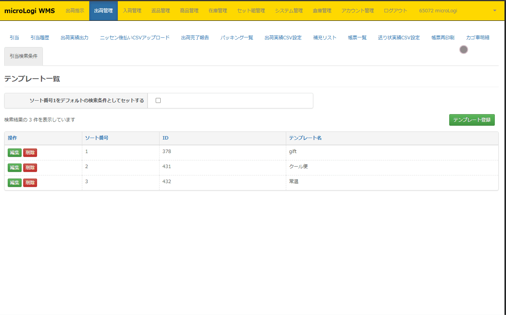
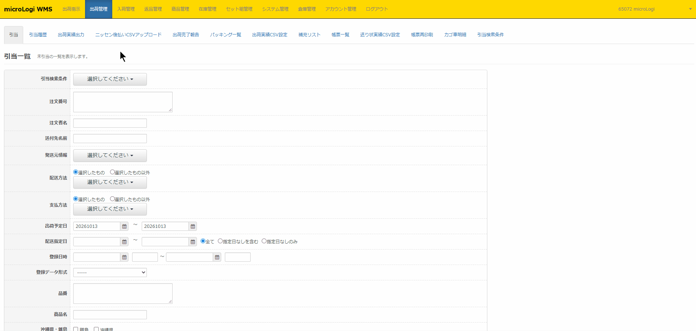
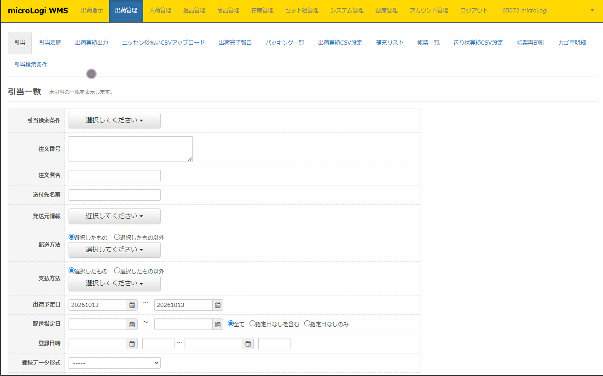
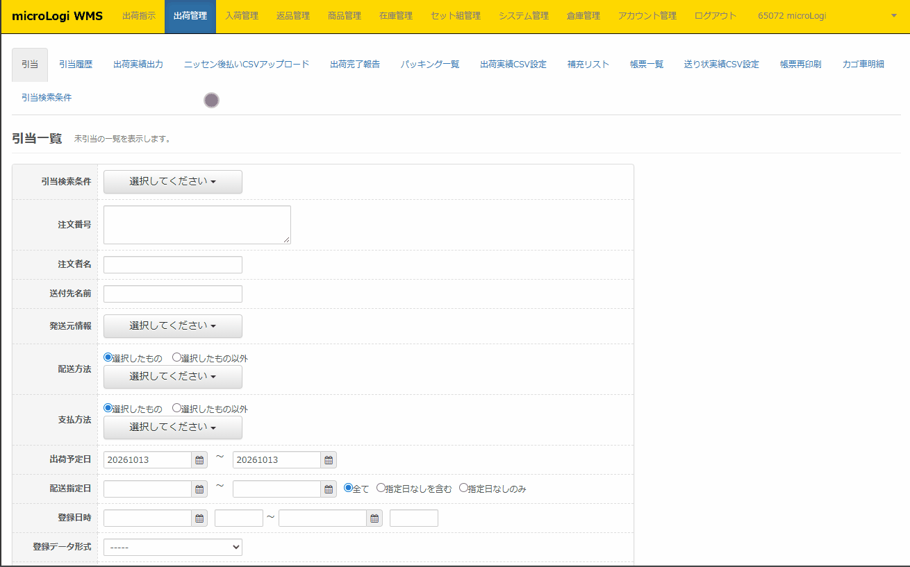

<h1>引当検索条件設定</h1>

引当操作時の検索条件を設定・登録することができます。  
日頃お使いの引当条件をテンプレート登録することにより、毎回の条件選択を軽減することができます。

 
本ページでは、以下について記載します。
   

**・[テンプレート登録](#h_01FVQ8W3D5E5XT3GSXS3BRRJET)**

**・[引当検索条件の表示順変更](#h_01GAG2XV4KP44PAFC4BX2P4HP0)**

**・[引当操作](#h_01GAG679FX0PR5WNJY0JYXNZDR)**
    
<h2 id="h_01FVQ8W3D5E5XT3GSXS3BRRJET">テンプレート登録</h2>

- *

日頃お使いの引当条件をテンプレートとして登録することができます。  
複数パターン登録が可能です。

  

  
①出荷管理＞引当検索条件設定

②【**テンプレート登録**】

③[各項目を任意で入力または選択](https://commerce-roboticshelp.zendesk.com/hc/article_attachments/9508394240537/__2.gif) \*テンプレート名は必須項目となります

④登録ボタン押下

   
<table style={{ borderCollapse: 'collapse', width: '110.285%', height: '224px' }} border="1"><tbody><tr style={{ height: '51px' }}><td style={{ width: '21.8683%', height: '51px' }}>テンプレート名（必須）</td><td style={{ width: '88.4174%', height: '51px' }}>
出荷管理＞引当検索条件設定のテンプレート一覧に表示させる名称

 引当画面に表示されて参りますので、認識しやすい名称を登録ください。
</td></tr><tr style={{ height: '22px' }}><td style={{ width: '21.8683%', height: '22px' }}>注文番号</td><td style={{ width: '88.4174%', height: '22px' }}>出荷指示登録したデータの注文番号で<strong>部分一致検索</strong>が可能です。</td></tr><tr style={{ height: '22px' }}><td style={{ width: '21.8683%', height: '22px' }}>注文者名</td><td style={{ width: '88.4174%', height: '22px' }}>出荷指示登録したデータの注文者名で<strong>部分一致検索</strong>が可能です。</td></tr><tr style={{ height: '22px' }}><td style={{ width: '21.8683%', height: '22px' }}>発送元情報</td><td style={{ width: '88.4174%', height: '22px' }}><a href="https://airlogi-help.zendesk.com/hc/ja/articles/4409251738137-%E7%99%BA%E9%80%81%E5%85%83%E4%B8%80%E8%A6%A7" rel="noopener noreferrer">システム管理＞発送元一覧</a>で登録した発送元を選択できます。</td></tr><tr style={{ height: '22px' }}><td style={{ width: '21.8683%', height: '22px' }}>配送方法</td><td style={{ width: '88.4174%', height: '22px' }}>
<a href="https://airlogi-help.zendesk.com/hc/ja/articles/4409360624025-%E3%82%B7%E3%83%A7%E3%83%83%E3%83%97%E4%B8%80%E8%A6%A7" rel="noopener noreferrer">アカウント管理＞ショップ一覧＞ショップ編集＞配送方法管理</a>で選択されて

いる配送方法の選択が可能です。
</td></tr><tr style={{ height: '22px' }}><td style={{ width: '21.8683%', height: '22px' }}>支払方法</td><td style={{ width: '88.4174%', height: '22px' }}>支払方法を選択することが可能です。</td></tr><tr style={{ height: '22px' }}><td style={{ width: '21.8683%', height: '22px' }}>出荷予定日</td><td style={{ width: '88.4174%', height: '22px' }}>
[当日]または[指定]～[日数]で範囲設定が可能です。

この項目を使用しない場合は[設定なし]を選択ください。

[当日]または[指定日]のみの場合は[日数]は空欄か０を入力ください。
</td></tr><tr><td style={{ width: '24.0444%' }}>配送指定日</td><td style={{ width: '97.413%' }}>
[当日]または[指定]～[日数]で範囲設定が可能です。

この項目を使用しない場合は[設定なし]を選択ください。

[当日]または[指定日]のみの場合は[日数]は空欄か０を入力ください。
</td></tr><tr><td style={{ width: '24.0444%' }}>登録日</td><td style={{ width: '97.413%' }}>
[当日]または[指定]～[日数]で範囲設定が可能です。

この項目を使用しない場合は[設定なし]を選択ください。

[当日]または[指定日]のみの場合は[日数]は空欄か０を入力ください。
</td></tr><tr style={{ height: '22px' }}><td style={{ width: '21.3301%', height: '22px' }}>登録データ形式</td><td style={{ width: '89.5559%', height: '22px' }}><a href="https://airlogi-help.zendesk.com/hc/ja/articles/4408719878297-%E5%87%BA%E8%8D%B7%E6%8C%87%E7%A4%BAEDI" rel="noopener noreferrer">出荷指示＞出荷指示EDI一覧</a>で作成した形式を選択することが可能です。</td></tr><tr style={{ height: '22px' }}><td style={{ width: '21.3301%', height: '22px' }}>品番</td><td style={{ width: '89.5559%', height: '22px' }}>出荷指示登録したデータ内の品番で<strong>部分一致検索</strong>が可能です。</td></tr><tr style={{ height: '22px' }}><td style={{ width: '21.3301%', height: '22px' }}>商品名</td><td style={{ width: '89.5559%', height: '22px' }}>出荷指示登録したデータ内の商品名で<strong>部分一致検索</strong>が可能です。</td></tr><tr style={{ height: '22px' }}><td style={{ width: '21.3301%', height: '22px' }}>沖縄県・離島</td><td style={{ width: '89.5559%', height: '22px' }}>選択をした条件での検索が可能です。</td></tr><tr style={{ height: '22px' }}><td style={{ width: '21.3301%', height: '22px' }}>ステータス</td><td style={{ width: '89.5559%', height: '22px' }}><a href="https://airlogi-help.zendesk.com/hc/ja/articles/4409102744601-%E5%BC%95%E5%BD%93" rel="noopener noreferrer">出荷管理＞引当</a>に登録されている出荷指示データのステータスで検索が可能です。</td></tr><tr style={{ height: '22px' }}><td style={{ width: '21.3301%', height: '22px' }}>倉庫備考</td><td style={{ width: '89.5559%', height: '22px' }}>
出荷指示登録したデータ内の倉庫備考内の文言で<strong>部分一致検索</strong>が可能です。
</td></tr><tr style={{ height: '22px' }}><td style={{ width: '21.3301%', height: '22px' }}>店舗備考</td><td style={{ width: '89.5559%', height: '22px' }}>出荷指示登録したデータ内の店舗備考内の文言で<strong>部分一致検索</strong>が可能です。</td></tr><tr style={{ height: '22px' }}><td style={{ width: '21.3301%', height: '22px' }}>登録ファイル名</td><td style={{ width: '89.5559%', height: '22px' }}><a href="https://airlogi-help.zendesk.com/hc/ja/articles/4408718906777-%E5%87%BA%E8%8D%B7%E3%83%87%E3%83%BC%E3%82%BF%E7%99%BB%E9%8C%B2" rel="noopener noreferrer">出荷指示＞出荷データ登録</a>で出荷指示を登録した際のファイル名で<strong>部分一致検索</strong>が可能です。</td></tr><tr style={{ height: '44px' }}><td style={{ width: '21.3301%', height: '44px' }}>出荷区分</td><td style={{ width: '89.5559%', height: '44px' }}>
出荷指示登録したデータ内の出荷区分からラジオボタンで検索が可能です。
</td></tr><tr style={{ height: '44px' }}><td style={{ width: '21.3301%', height: '44px' }}>キャンセル</td><td style={{ width: '89.5559%', height: '44px' }}>
<a href="https://airlogi-help.zendesk.com/hc/ja/articles/4409102744601-%E5%BC%95%E5%BD%93" rel="noopener noreferrer">出荷管理＞引当</a>に登録されている出荷指示データで、[全て][キャンセル][キャンセル以外]から選択が可能です。
</td></tr><tr style={{ height: '22px' }}><td style={{ width: '21.3301%', height: '22px' }}>温度区分</td><td style={{ width: '89.5559%', height: '22px' }}>出荷指示登録したデータ内容の温度区分を選択することが可能です。</td></tr><tr style={{ height: '22px' }}><td style={{ width: '21.3301%', height: '22px' }}>総ピック数</td><td style={{ width: '89.5559%', height: '22px' }}>
出荷指示登録したデータ内の総ピック数（全カテゴリー）の選択が可能です。

＊[商品]以外で商品マスタ登録している[同梱物][作業][おまけ][資材]も含まれます。
</td></tr><tr style={{ height: '22px' }}><td style={{ width: '21.3301%', height: '22px' }}>ギフトフラグ</td><td style={{ width: '89.5559%', height: '22px' }}>
出荷指示登録したデータ内のギフトフラグで選択が可能です。
</td></tr><tr style={{ height: '22px' }}><td style={{ width: '21.3301%', height: '22px' }}>納品書出力</td><td style={{ width: '89.5559%', height: '22px' }}>
出荷指示登録したデータ内の納品書出力の有無から選択が可能です。
</td></tr><tr style={{ height: '22px' }}><td style={{ width: '21.3301%', height: '22px' }}>倉庫備考</td><td style={{ width: '89.5559%', height: '22px' }}>
出荷指示登録したデータ内の倉庫備考の有無から選択が可能です。
</td></tr><tr style={{ height: '10px' }}><td style={{ width: '21.3301%', height: '10px' }}>箱サイズ</td><td style={{ width: '89.5559%', height: '10px' }}>
箱サイズを指定することが可能です。
</td></tr><tr style={{ height: '51px' }}><td style={{ width: '21.3301%', height: '51px' }}>
総ピック数

（カテゴリー別）
</td><td style={{ width: '89.5559%', height: '51px' }}>出荷指示登録したデータ内のカテゴリー別総ピック数の値を指定することが可能です。</td></tr></tbody></table>
   
<h2 id="h_01GAG2XV4KP44PAFC4BX2P4HP0">引当検索条件の表示順変更</h2>

- *

登録したテンプレートの表示順を変更することが可能です。  
また、設定した項目のみ【引当検索条件】に表示させることも可能です。

  
◆【引当検索条件】の表示項目の最上位を\[検索条件なし\]とする場合◆
  

  

①出荷管理＞引当検索条件設定＞テンプレート一覧

②表示の順番を変更したい場合は、移動希望の位置まで移動させる

③出荷管理＞引当 引当一覧にてソート番号順にプルダウンに表示されます。
   

◆【引当検索条件】の表示項目の最上位に設定をした検索条件にする場合◆
  

  
\[ソート番号1をデフォルトの検索条件としてセットする\]に☑を入れることにより

検索条件ナシがデフォルトとならず、ソート番号１番がデフォルトとして表示されます。
  
<h2 id="h_01GAG679FX0PR5WNJY0JYXNZDR">引当操作</h2>

- *

出荷管理＞引当メニューで登録した検索条件で検索を行うことができます。

  
①出荷管理＞引当＞引当一覧 引当検索条件

②検索に使用するテンプレート名の選択

③検索条件を切り替える場合は、プルダウンで条件選択後に【**検索**】ボタンを押下ください。