<h1>送り状実績CSV設定</h1>

送り状実績CSV設定では、送り状システムに取り込む際のCSVデータのレイアウトを自由に作成できます。 
また引当履歴からも作成したデータを出力することができるため、 
自動梱包機取込み用のデータや後払いシステム取込み用のデータを作成することも可能です。

本ページでは以下項目について記載いたします。

-   [**送り状実績CSV設定 新規作成方法**](#h_01FVFC4VV29FNRRQ8188N0HMGB)
-   [**標準送り状CSVレイアウト複製方法**](#h_01FVFDWJ06X3C7EHQY1N8X98JQ)

<h2 id="h_01FVFC4VV29FNRRQ8188N0HMGB">送り状実績CSV設定 新規作成方法</h2>

* * *

送り状CSVレイアウトは以下手順で新規作成可能です。

<h3>引当履歴画面から出力する送り状CSVレイアウト 新規作成方法</h3>

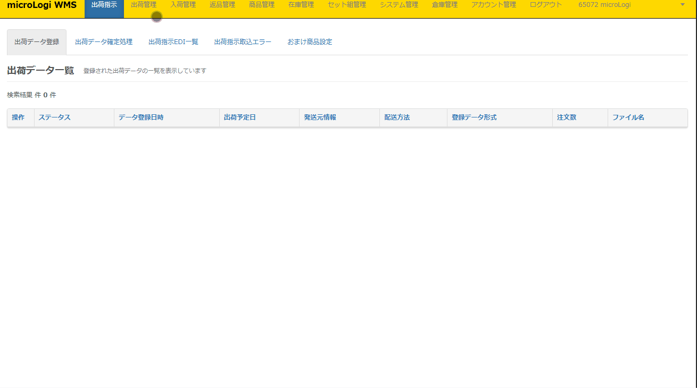

①　出荷管理＞送り状実績CSV設定

②［**新規CSV出力設定**］をクリック

③　以下項目を入力

\- **出力名**　　　　　：出荷管理＞引当履歴＞送り状にて選択可能なラジオボタン左横に表示させる  
名称を入力します。  
      出力時にどのようなデータか、分かりやすい名称をご登録ください。

\- **出力ファイル名**　：こちらの項目に入力した値＋yyyymmddにてファイルが出力されます。  
   出力時に判別しやすい名称をご登録ください。

\- **ヘッダーを非表示**：「カラム名」に入力する値をデータ出力時に1行目に出力させるか否か、  
                                   　　を選択します。ヘッダーを出力させない場合はチェックを入れてください。

\- **文字コード**　：『UTF-8形式』を選択できるようにする。UTF-8で出したい場合はチェックを入れ  
てください。

④　［行追加］ボタンで出力させたい列分、行を追加し以下項目を入力し［**登録**］をクリック

\- **処理順**　　　　　：CSVデータを生成する際の処理の順番を入力します。  
   　　　　　　  通常は上から順に1, 2, 3...と入力します。

\- **列番号**　　　　　：CSVデータに出力させる列番号を入力します。

\- **カラム名**　　　　：CSVデータの1行目ヘッダー行に出力させる項目名を入力します。

\- **条件**　　　　　　：CSVデータにデータを出力させる条件を指定します。  
   　　　　　　　「なし」「データを指定」「列を指定」を選択できます。  
                  　　　　　　　 通常は「なし」を選択してください。条件設定方法は[こちら](https://airlogi-help.zendesk.com/hc/ja/articles/9082292334617)

\- **処理**　　　　　　：CSVデータにデータを出力させる際の処理方法を選択します。  
「データを出力」「指定列を出力」「行を出力しない」「固定値出力」「文字列抽出」  
「文字列置換」「当日日時出力」「日付フォーマット」「配送方法コード置換」が選択  
    　 できます。通常は「データを出力」を選択、該当列に出力したい項目を選択します。  
             　　　　　       　   データを出力以外の処理設定方法は[こちら](https://airlogi-help.zendesk.com/hc/ja/articles/9082292334617)

⑤　本画面で作成したレイアウトは[**出荷管理＞引当履歴の送り状🖊**](https://airlogi-help.zendesk.com/hc/ja/articles/4409180945561)にてのみ出力いただけます。

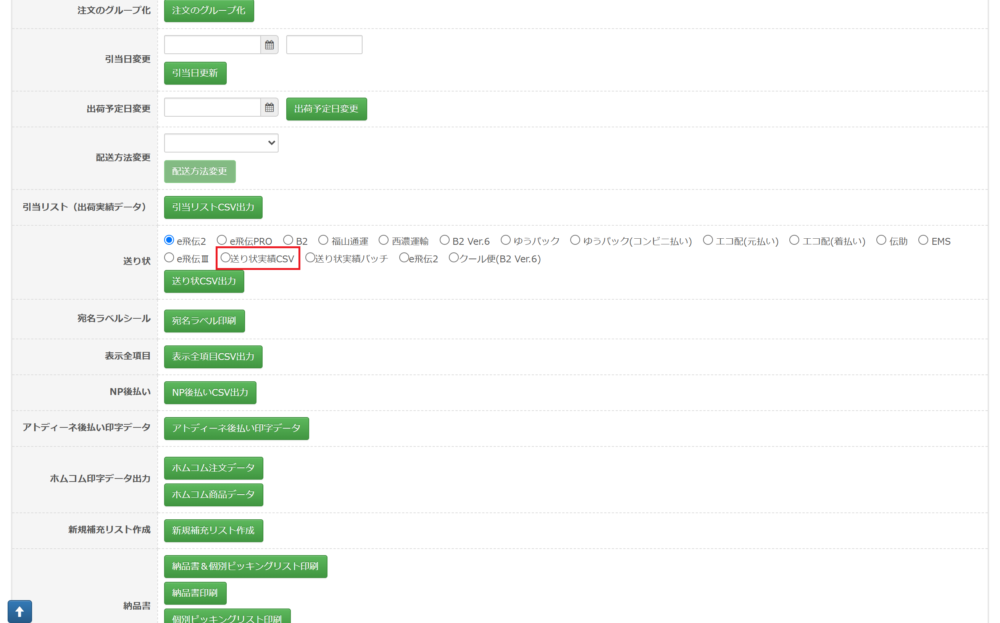

<h2 id="h_01FVFDWJ06X3C7EHQY1N8X98JQ">標準送り状CSVレイアウト複製方法</h2>

* * *

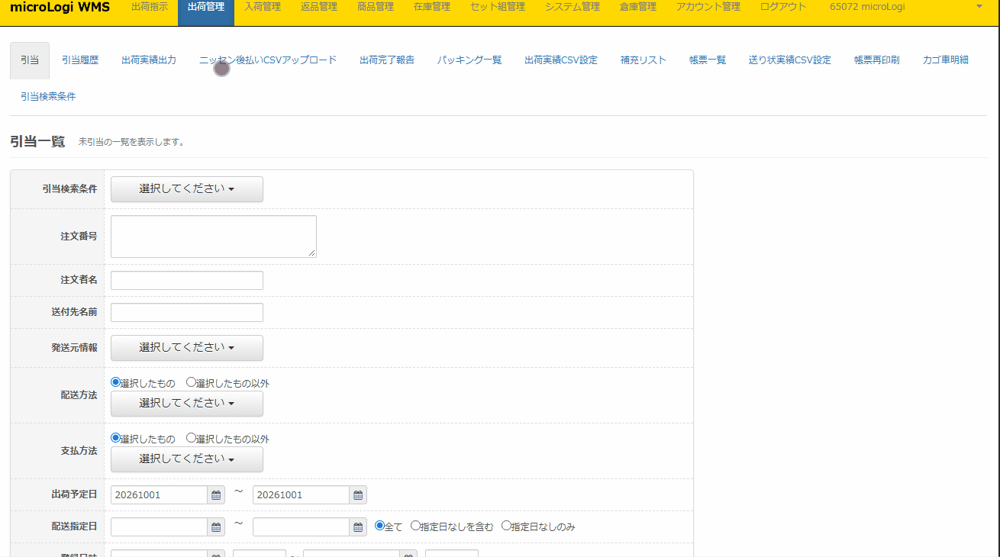

①　出荷管理＞送り状実績CSV設定

②　複製したい標準レイアウトの［**編集**］ボタンをクリック

③　必要に応じて出力名や出力名を変更し、紐づけ等を変更し［**変更**］ボタンをクリック

④　複製されたレイアウトで送り状CSVをダウンロードできるようになります。

【2024年1月24日(水)のアップデートにて下記の仕様変更が行われます。】

・「B2ver6」の場合、ヤマト系の配送方法（ヤマト宅急便・宅急便コンパクト・ネコポス・クロネコゆうパケット）の注文のみが出力対象となります。

・「e飛伝Ⅲ」の場合、佐川急便の注文のみが出力対象となります。

・標準の「B2ver6」「e飛伝Ⅲ」を複製して独自の送り状CSVフォーマットを作成された場合も、同様の挙動となります。

別配送会社の注文を「B2ver6」および「e飛伝Ⅲ」にて出力される場合、CSVの出力口を新規でご作成頂きますよう、よろしくお願いいたします。

## **出力できる項目について**

下記の項目が出力可能です。

<table border="1"><tbody><tr><td>項目名</td><td>参照元</td><td>出力内容</td></tr><tr><td>商品規格２</td><td>商品マスタ</td><td>規格２が出力されます。</td></tr><tr><td>商品規格１</td><td>商品マスタ</td><td>商品マスタの規格１が出力されます。</td></tr><tr><td>佐川依頼主住所（全て）</td><td>出荷指示</td><td>
注文に紐づく発送元のショップ住所が出力されます。

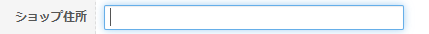</img>
</td></tr><tr><td>佐川お届先住所</td><td>出荷指示</td><td>送付先住所１～３が結合された値が出力されます。</td></tr><tr><td>佐川代引消費税金額10％</td><td>&nbsp;</td><td>&nbsp;</td></tr><tr><td>佐川着店コード</td><td>micrologi</td><td>送付先住所に基づいた佐川急便の着店コードが出力されます。</td></tr><tr><td>重量</td><td>出荷指示</td><td>
重量に登録した値が出力されます。

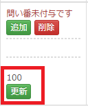</img>
</td></tr><tr><td>送付先国コードID</td><td>出荷指示</td><td>
送付先の国コードIDが出力されます。 出力されるIDは下記のようになっております。

１：日本 ２：アンドラ　・・・
</td></tr><tr><td>注文者国コードID</td><td>出荷指示</td><td>
注文者の国コードIDが出力されます。 出力されるIDは下記のようになっております。

１：日本 ２：アンドラ　・・・
</td></tr><tr><td>送付先州</td><td>出荷指示</td><td>
送付先州/都市に登録した値が出力されます。

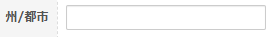</img>
</td></tr><tr><td>注文者州</td><td>出荷指示</td><td>
注文者州/都市に登録した値が出力されます。

</img>
</td></tr><tr><td>品名２ ※全角の「２」</td><td>&nbsp;</td><td>現在ご利用頂けません。（削除を検討中です。）</td></tr><tr><td>発行枚数</td><td>&nbsp;</td><td>&nbsp;</td></tr><tr><td>お届け先名称２</td><td>&nbsp;</td><td>&nbsp;</td></tr><tr><td>ご依頼主名称２</td><td>&nbsp;</td><td>&nbsp;</td></tr><tr><td>代引金額</td><td>&nbsp;</td><td>&nbsp;</td></tr><tr><td>独自５</td><td>出荷指示</td><td>
注文拡張5の値が出力されます。

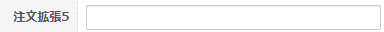</img>
</td></tr><tr><td>独自４</td><td>出荷指示</td><td>
独自4の値が出力されます。

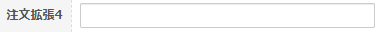</img>
</td></tr><tr><td>品名２ ※半角の「2」</td><td>ショップ設定</td><td>
完全新規で作成したフォーマット →　 何も出力されません。

完全新規で作成したフォーマット以外（標準フォーマットや標準フォーマットを複製して生成したフォーマット） → ショップ設定＞品名＞「品名2」の値が出力されます。

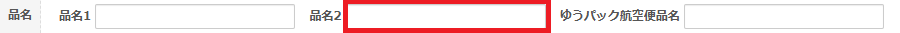</img>

 ※B2 Ver6（もしくはB2 Ver6を複製したフォーマット）で、B2点数表示「有」にしても、総点数の値は付加されません。
</td></tr><tr><td>日本郵便仕分けコード</td><td>micrologi</td><td>日本郵便の仕分けコードが出力されます。</td></tr><tr><td>得意先ID</td><td>&nbsp;</td><td>&nbsp;</td></tr><tr><td>総商品重量</td><td>&nbsp;</td><td>&nbsp;</td></tr><tr><td>問い合わせ番号</td><td>出荷指示</td><td>
追跡番号の値が出力されます。

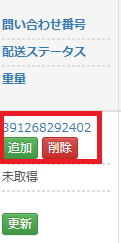</img>
</td></tr><tr><td>便種コード</td><td>&nbsp;</td><td>&nbsp;</td></tr><tr><td>送付先名_4</td><td>&nbsp;</td><td>&nbsp;</td></tr><tr><td>送付先名_3</td><td>&nbsp;</td><td>&nbsp;</td></tr><tr><td>送付先名_2</td><td>&nbsp;</td><td>&nbsp;</td></tr><tr><td>送付先名_1</td><td>&nbsp;</td><td>&nbsp;</td></tr><tr><td>送り状種類</td><td>&nbsp;</td><td>&nbsp;</td></tr><tr><td>サイズ</td><td>&nbsp;</td><td>運送会社： ゆうパケット&nbsp; 送り状：ゆうパック 、ゆうパック(コンビニ払い) 上記運送会社と送り状の時固定３０で出力</td></tr><tr><td>入力機種</td><td>&nbsp;</td><td>&nbsp;</td></tr><tr><td>荷扱い</td><td>&nbsp;</td><td>&nbsp;</td></tr><tr><td>メッセージを送る</td><td>&nbsp;</td><td>&nbsp;</td></tr><tr><td>メール送信</td><td>&nbsp;</td><td>&nbsp;</td></tr><tr><td>運賃管理番号</td><td>&nbsp;</td><td>&nbsp;</td></tr><tr><td>ご請求先分類コード</td><td>&nbsp;</td><td>&nbsp;</td></tr><tr><td>消費税</td><td>&nbsp;</td><td>&nbsp;</td></tr><tr><td>注文ID</td><td>micrologi</td><td>注文IDが出力されます。 micrologiというシステムでユニークなIDです。</td></tr><tr><td>荷主コード</td><td>&nbsp;</td><td>&nbsp;</td></tr><tr><td>出荷区分</td><td>&nbsp;</td><td>&nbsp;</td></tr><tr><td>シールコード４</td><td>&nbsp;</td><td>&nbsp;</td></tr><tr><td>シールコード３</td><td>&nbsp;</td><td>&nbsp;</td></tr><tr><td>シールコード２</td><td>&nbsp;</td><td>&nbsp;</td></tr><tr><td>シールコード１</td><td>&nbsp;</td><td>&nbsp;</td></tr><tr><td>品名</td><td>ショップ設定</td><td>
ショップ設定＞品名＞「品名1」の値が出力されます。

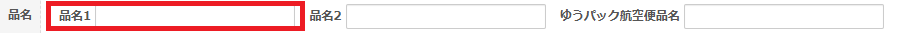</img>
</td></tr><tr><td>お届け予定日</td><td>&nbsp;</td><td>&nbsp;</td></tr><tr><td>お届け予定月</td><td>&nbsp;</td><td>&nbsp;</td></tr><tr><td>配達方法</td><td>&nbsp;</td><td>&nbsp;</td></tr><tr><td>着払い/代引き</td><td>&nbsp;</td><td>&nbsp;</td></tr><tr><td>商品</td><td>&nbsp;</td><td>&nbsp;</td></tr><tr><td>管理番号</td><td>&nbsp;</td><td>&nbsp;</td></tr><tr><td>西濃荷主人コード</td><td>&nbsp;</td><td>&nbsp;</td></tr><tr><td>注文日時</td><td>出荷指示</td><td>
注文日時が出力されます。

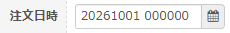</img>
</td></tr><tr><td>ギフト</td><td>&nbsp;</td><td>&nbsp;</td></tr><tr><td>購入者の住所</td><td>&nbsp;</td><td>&nbsp;</td></tr><tr><td>受信者アドレス</td><td>&nbsp;</td><td>&nbsp;</td></tr><tr><td>配送方法１</td><td>&nbsp;</td><td>&nbsp;</td></tr><tr><td>着店営業所コード</td><td>&nbsp;</td><td>&nbsp;</td></tr><tr><td>配達時間指定</td><td>&nbsp;</td><td>&nbsp;</td></tr><tr><td>店舗備考</td><td>出荷指示</td><td>
店舗備考の内容が出力されます。

</img>
</td></tr><tr><td>商品拡張１</td><td>&nbsp;</td><td>&nbsp;</td></tr><tr><td>商品名</td><td>出荷指示</td><td>1明細目の品名の値が出力されます。</td></tr><tr><td>送料を含む</td><td>&nbsp;</td><td>&nbsp;</td></tr><tr><td>発送局コード</td><td>&nbsp;</td><td>&nbsp;</td></tr><tr><td>発送元名前１/発送元名前２</td><td>&nbsp;</td><td>&nbsp;</td></tr><tr><td>佐川ご依頼主コード</td><td>&nbsp;</td><td>&nbsp;</td></tr><tr><td>店舗名</td><td>&nbsp;</td><td>&nbsp;</td></tr><tr><td>認証番号</td><td>&nbsp;</td><td>&nbsp;</td></tr><tr><td>コンビニ等店舗名</td><td>出荷指示</td><td>出荷指示登録で取り込んだ値がそのまま出力されます。</td></tr><tr><td>コンビニ店舗コード</td><td>出荷指示</td><td>出荷指示登録で取り込んだ値がそのまま出力されます。</td></tr><tr><td>コンビニ事業者名</td><td>出荷指示</td><td>出荷指示登録で取り込んだ値がそのまま出力されます。</td></tr><tr><td>コンビニ等コード</td><td>出荷指示</td><td>出荷指示登録で取り込んだ値がそのまま出力されます。</td></tr><tr><td>コンビニ等判別コード</td><td>出荷指示</td><td>出荷指示登録で取り込んだ値がそのまま出力されます。</td></tr><tr><td>グルーピングID</td><td>&nbsp;</td><td>&nbsp;</td></tr><tr><td>発送元名前２</td><td>&nbsp;</td><td>&nbsp;</td></tr><tr><td>発送元名前１</td><td>&nbsp;</td><td>&nbsp;</td></tr><tr><td>発送元住所２</td><td>
発送元一覧

出荷指示

ショップ設定
</td><td>「発送元住所1」が長くなった場合に、途中から発送元住所2の列に値が入ります。 〇B2 Ver6　もしくは　これを複製したフォーマット →Shift-JIS換算で発送元住所の49バイト目以降が発送元住所2に移る 〇e飛伝3　もしくは　これを複製したフォーマット →Shift-JIS換算で発送元住所の33バイト目以降が発送元住所2に移る 〇ゆうプリR　もしくは　これを複製したフォーマット →Shift-JIS換算で発送元住所の51バイト目以降が発送元住所2に移る 〇完全新規で作成したフォーマット →Shift-JIS換算で発送元住所の51バイト目以降が発送元住所2に移る</td></tr><tr><td>発送元住所１</td><td>
発送元一覧

出荷指示

ショップ設定
</td><td>
〇基本的に、 ・標準で用意されている送り状CSVフォーマット ・上記を複製して作成した送り状CSVフォーマット については、システム管理＞発送元一覧の住所を参照しています。

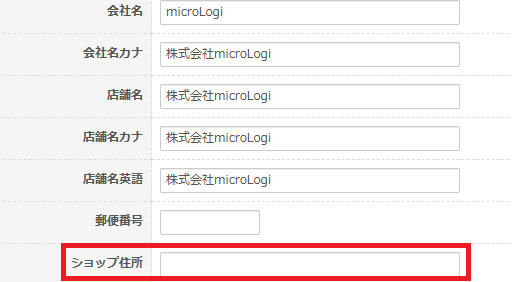</img>

〇アカウント管理＞ショップ一覧にて、「注文者と送付先が違う場合は依頼主を注文者に設定する」にチェックが入っており、かつ注文者と送付先が違う注文の場合、 ・標準で用意されている送り状CSVフォーマット ・上記を複製して作成した送り状CSVフォーマット については、注文者の情報を参照しています。

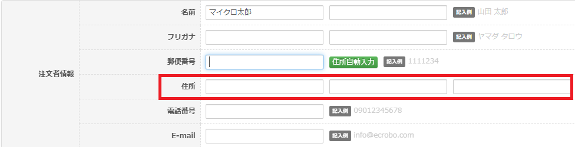</img>

〇・完全新規で作成した送り状CSVフォーマット（複製をせずにいちから作成した送り状CSVフォーマット）については、 アカウント管理＞ショップ一覧の情報を参照しています。 ※「注文者と送付先が違う場合は依頼主を注文者に設定する」のチェックも関係なし

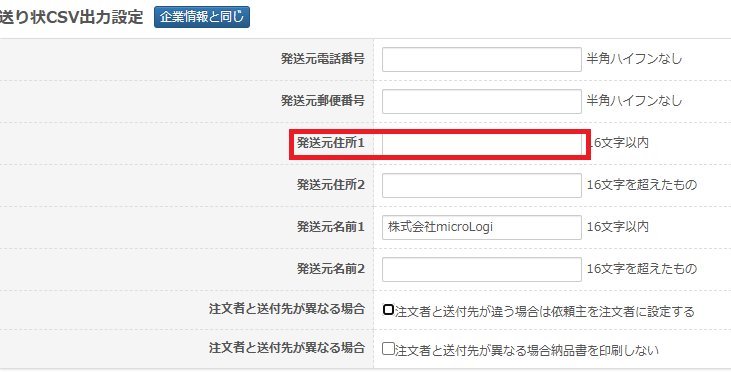</img>
</td></tr><tr><td>発送元郵便番号</td><td>&nbsp;</td><td>&nbsp;</td></tr><tr><td>発送元電話番号</td><td>&nbsp;</td><td>&nbsp;</td></tr><tr><td>注文者メールアドレス</td><td>出荷指示</td><td>
注文者メールアドレスが出力されます。

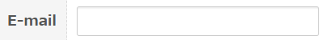</img>
</td></tr><tr><td>独自１</td><td>出荷指示</td><td>
注文拡張１が出力されます。

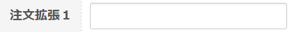</img>
</td></tr><tr><td>独自２</td><td>出荷指示</td><td>
注文拡張２が出力されます。

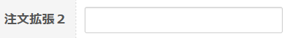</img>
</td></tr><tr><td>独自３</td><td>出荷指示</td><td>
注文拡張３が出力されます。

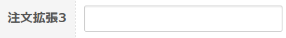</img>
</td></tr><tr><td>請求金額</td><td>出荷指示</td><td>
請求金額の値が出力されます。

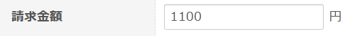</img>
</td></tr><tr><td>個口数</td><td>出荷指示</td><td>
個口数の値が出力されます。

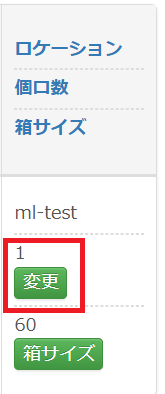</img>
</td></tr><tr><td>支払い方法</td><td>出荷指示</td><td>&nbsp;</td></tr><tr><td>配送方法</td><td>出荷指示</td><td>&nbsp;</td></tr><tr><td>営業所止置き</td><td>&nbsp;</td><td>&nbsp;</td></tr><tr><td>送り状備考１</td><td>出荷指示</td><td>
送り状備考１が出力されます。

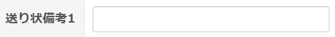</img>
</td></tr><tr><td>送り状備考２</td><td>出荷指示</td><td>
送り状備考２が出力されます。

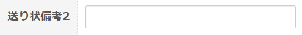</img>
</td></tr><tr><td>送り状備考３</td><td>出荷指示</td><td>
送り状備考3が出力されます。

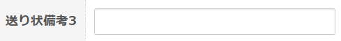</img>
</td></tr><tr><td>SKU数</td><td>出荷指示</td><td>SKU数を出力します。</td></tr><tr><td>商品総数</td><td>出荷指示</td><td>総点数を出力します。</td></tr><tr><td>注文者名</td><td>出荷指示</td><td>
注文者名が出力されます。

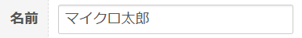</img>
</td></tr><tr><td>注文者名（カナ）</td><td>出荷指示</td><td>
注文者名（カナ）が出力されます。

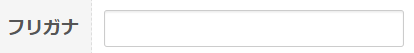</img>
</td></tr><tr><td>注文者住所１</td><td>出荷指示</td><td>
注文者住所１が出力されます。

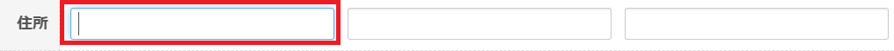</img>
</td></tr><tr><td>注文者住所２</td><td>出荷指示</td><td>
注文者住所２が出力されます。

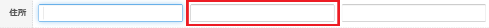</img>
</td></tr><tr><td>注文者住所３</td><td>出荷指示</td><td>
注文者住所3が出力されます。

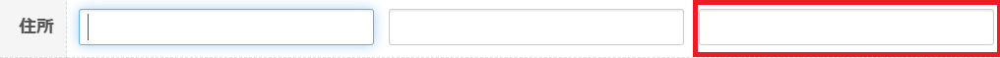</img>
</td></tr><tr><td>注文者郵便番号</td><td>出荷指示</td><td>
注文者郵便番号が出力されます。

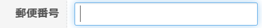</img>
</td></tr><tr><td>注文者電話番号</td><td>出荷指示</td><td>
注文者電話番号が出力されます。

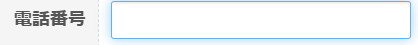</img>
</td></tr><tr><td>送付先名</td><td>出荷指示</td><td>
送付先名が出力されます。

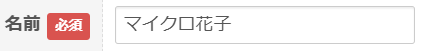</img>
</td></tr><tr><td>送付先名（カナ）</td><td>出荷指示</td><td>
送付先名（カナ）が出力されます。

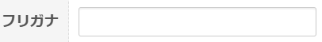</img>
</td></tr><tr><td>送付先住所１</td><td>出荷指示</td><td>
送付先住所１が出力されます。

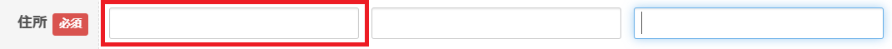</img>
</td></tr><tr><td>送付先住所２</td><td>出荷指示</td><td>
送付先住所２が出力されます。

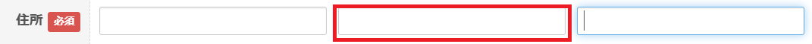</img>
</td></tr><tr><td>送付先住所３</td><td>出荷指示</td><td>
送付先住所３が出力されます。

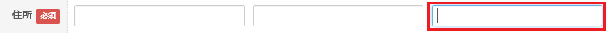</img>
</td></tr><tr><td>送付先郵便番号</td><td>出荷指示</td><td>
送付先郵便番号が出力されます。

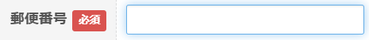</img>
</td></tr><tr><td>送付先電話番号</td><td>出荷指示</td><td>送付先電話番号が出力されます。 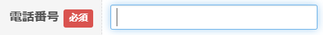</img></td></tr><tr><td>送付先メールアドレス</td><td>出荷指示</td><td>送付先メールアドレスが出力されます。 CSVで登録した値が出力されます。</td></tr><tr><td>配送時間</td><td>出荷指示</td><td>
配送時間の値が出力されます。

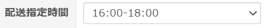</img>

下記の値で出力されます。

午前中：01 12時～14時：12 14時～16時：14 16時～18時：16 18時～20時：18 19時～21時：19 20時～21時：20
</td></tr><tr><td>配送指定日</td><td>出荷指示</td><td>
配送指定日の値が出力されます。

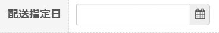</img>
</td></tr><tr><td>出荷予定日</td><td>出荷指示</td><td>
出荷予定日の値が参照されます。

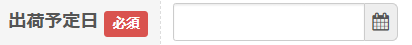</img>
</td></tr><tr><td>温度区分</td><td>出荷指示</td><td>
温度区分の値が出力されます。

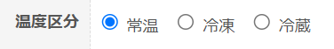</img>
</td></tr><tr><td>注文番号</td><td>出荷指示</td><td>
注文番号の値が出力されます。

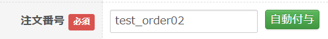</img>
</td></tr><tr><td>着店バーコード</td><td>&nbsp;</td><td>佐川着店コードの右から３桁を切り出す ※桁数は３桁固定&nbsp;</td></tr><tr><td>着店コード</td><td>&nbsp;</td><td>佐川着店コードの右から３桁を除外した残りのデータ ※桁数は２桁～４桁の想定</td></tr><tr><td>着店ローカルコード</td><td>&nbsp;</td><td>佐川着店コードの7桁になるように「$」で桁埋めして、 先頭に「c」、末尾に「d」を連結する。 ※桁数は合計で9桁固定</td></tr><tr><td>お届け予定eメール利用区分</td><td>&nbsp;</td><td>
固定値で「1」
<figure className="wysiwyg-image">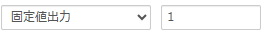</img></figure></td></tr><tr><td>&nbsp;「お届け予定eメールe-mailアドレス」</td><td>　出荷指示</td><td>
送付先メールアドレスが出力されます。
<figure className="wysiwyg-image">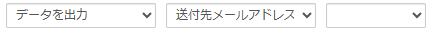</img></figure></td></tr><tr><td>お届け予定eメールメッセージ</td><td>　出荷指示</td><td>本文に表示するメッセージを入力してください。（半角148文字全角74文字以内）</td></tr></tbody></table>